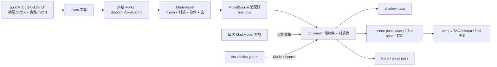

# goal-svox.md —— 微体素（SVOX）模型系统：完整方案

状态：方案，未实现。契约部分已写进 `goal-renderapi.ts` §2c / D-13 / D-14，本文是它的全文依据与落地计划。
基准（沿用 goal-renderapi.ts）：**rgl（?r=gl）是基准渲染器，宿主 B 是主宿主**；宿主 A / v2 只要求不被破坏（缺省行为不变）。

参考：`goodMob/`（README.md、MAT.md、`svox-cht`、`plugin/*`、`src/*`、`reference-ents/` 17 个模型）、`rgl/entity.js`、`rgl/long/fancy.js`、`vendor/gl/renderer.js`。

---

## 1. 目标与非目标

目标

1. 生物、掉落物、手持物、方块里的装饰模型，都用**平滑体素**（Smooth Voxels 的低模输出）表示，在 rgl 里享受与方块同级的光照：直射 + 阴影图、天空环境、火把光、SSR、体积光、bloom、雾。
2. 真源是一段 **SVOX 文本**（可粘进 Smooth Voxels Playground，可被 goodMob 的 Blockbench 插件编辑），渲染器与它的格式解耦。
3. 材质支持：不透明 PBR、自发光、unlit、**玻璃（折射 / 吸收）**、木头（各向异性 + SSS + 孔隙并存）。
4. 模型与方块体素**对齐**：1 体素 = 1/16 格 = 一个 16px 贴图 texel；碰撞盒从体素生成，与渲染同源。
5. 热重载：外部改 SVOX → 游戏里不刷新就变。

非目标

- 游戏内模型 / 材质编辑器（编辑在 goodMob 做，游戏只热重载，§9）。
- SVOX 的 `toon / matcap / normal` 材质、贴图类属性（`map / normalmap / envmap` 的 `%ENVIRONMENT%` 是 Playground 专用，MAT.md G7）。
- 取代方块贴图管线；方块仍走 `TextureSource` + 区块网格。

## 2. 现状证据（为什么需要新路径）

| 事实 | 出处 | 后果 |
|---|---|---|
| 实体由宿主 three 画进离屏 `entRT`，再由 `entComp` 合并进 scene | `rgl/index.js` `R.onEntities`，`rgl/entity.js` | 不走 `fancy` 着色器：没有阴影图、没有 PBR |
| 实体光照 = CPU 一个半球平均乘子，写进 `material.color` | `rgl/entity.js` `createEntityLight` | 没有逐像素法线、没有朝向差异、没有投影 |
| `entComp` 写死 `gbuf = (0,0,-1,0)`，`b=-1` 标记「实体像素」 | `rgl/entity.js` `entComp`、`rgl/long/comp.js:212` | 实体无 SSR；TAA 对实体不用历史（因为没有运动向量） |
| `fancy` 末尾已输出 `o2 = (octEnc(N), rough, ssrW)` | `rgl/long/fancy.js:427` | 想要真 PBR 的实体，只需进 `fancy` 同级的着色器 |
| 阴影 pass 已经画 `dyn`，scene pass 在 `drawEntities` 画 `dyn` | `vendor/gl/renderer.js:272,299` | 动态网格进阴影与 scene 的口子已存在 |
| `dyn` = 28 字节顶点、按**四边形**画（`(n>>2)*6` 个索引）、颜色靠图集层号 | `vendor/gl/shared.js:854–866`，`renderer.js:361` | 不能装任意三角形 + 顶点色；**新建绘制集** |
| 区块段同为 28 字节四边形格式 | `renderer.js:270` | 方块里的模型不能进区块网格 |
| 材质贴图通道：`_s` R=光滑、G=F0（≥230 金属）、B=孔隙或 SSS 二选一、A=自发光 | `fancy.js:307–309,462` | 逐材质的粗糙 / 金属 / 自发光 / SSS+孔隙并存都没有 |
| 半透明只有 alpha 混合，且 `mat>=2` 时 `o2=0`（无 SSR） | `fancy.js:465–466` | 玻璃要新 pass |
| 折射只有水，IOR 写死 1.33 | `rgl/long/water.js:255` | 玻璃的折射可借鉴它的采样，IOR 参数化 |
| rgl 的 `BlockTable` 只有数组视图；`box/layer/ladder/door` 先按整格；无 `state()` / `boxes()` | `rgl/host-b.js:32`，goal-renderapi.ts §2 | 方块模型要先补 `state()` / `boxes()` |
| goodMob 已能：导入 / 导出 SVOX、颜色层 → 材质、17 个参考模型、greedy 体素 → 盒（`src/boxes.js`）、Smooth Voxels 在 worker 里跑 | `goodMob/README.md` | 编辑器与烘焙器的基础已在 |

## 3. 总体架构



分工：

- **宿主**（host-b.js）：持有 SVOX 文本、烘焙（worker）、`ModelSource`、方块定义（`Kind.Model`）、实体列表（`entities()`）、碰撞（`boxes()`）。
- **渲染器**（rgl）：只认 `ModelAsset`，不认 SVOX。负责 GPU 缓冲、材质表、阴影、光照、玻璃。
- **goodMob**：编辑与导出，不进游戏运行时。

## 4. 数据格式

### 4.1 真源：SVOX 文本

- 一个模型 = 一段 SVOX 文本。体素、颜色层、材质（`material` / `define`）、`scale`、`origin`、`ao`、`shape`、`resize` 都在里面。
- goodMob 的约定：一个 **layer = 一个 SVOX 材质里的一个颜色**；同一 SVOX 材质可含多种颜色（`fade` 要靠它，MAT.md G1）。
- 颜色 id 保持稳定（MAT.md G8）：`shell` 按颜色 id 引用。

### 4.2 旁路 JSON（SVOX 表达不了的）

放同名 `.json`，不往 SVOX 文本里塞：

| 内容 | 键 | 说明 |
|---|---|---|
| 骨骼 | `parts[]` | `name / parent / pivot / layers[]`：哪些颜色层（或 SVOX `group`）属于哪个部件；枢轴单位 = 体素 |
| 动画 | `clips{}` | 每部件的四元数 + 位移，逐帧；刚性，不做蒙皮 |
| 锚点 | `anchors{}` | 手持位置、眼睛、嘴 |
| 碰撞覆盖 | `boxes[]` | 缺省由体素 greedy 生成 |
| 光照 / 阴影开关 | `shadow` | 小物件可关 |

`svox` 与旁路 JSON 都存在则一起进 `ModelAsset.sidecar`，**未核实**：SVOX 的 `group` 是否能被库直接拆成独立网格（MAT.md D1 只说 group 变换已生成的网格）。骨骼拆分按"颜色层 → 部件"自己做，不依赖 `group`。

### 4.3 对齐约定

| 项 | 约定 |
|---|---|
| 体素尺寸 | 1 体素 = 1/16 格（`scale = 1/16`）= 16px 贴图的 1 texel |
| 轴 | 模型空间 = SVOX 轴（x 右、y 上、z 后）；goodMob 作者轴（z 上、前 = −y）→ SVOX 的映射沿用 `goodMob/src/svox.js` |
| 方块模型原点 | 体素原点 = 格角；`origin` 指定偏移（体素） |
| 实体模型原点 | 脚下中心；`origin = x -y z`（SVOX 的 `origin` 语法） |
| 尺寸 | 方块模型不限于 16³：可以超出格（门、床、柱）但要声明占用的格数，见 §8.1 |
| 碰撞 | **从体素生成**（`src/boxes.js` 的 greedy），不用平滑后的网格 |
| 剔除包围盒 | 体素 AABB 外扩 `deform / scatter / warp` 的最大位移（烘焙时算）；只用于剔除 |

### 4.4 烘焙产物 `ModelAsset`（见 goal-renderapi.ts §2c）

- `mesh`：`pos(f32×3)`、`nrm(oct snorm16×2)`、`col(u8×4：rgb + AO)`、`mat(u16)`、`idx(u32)`，按部件分段。
- `materials[]`：rgl 自己的 PBR 超集（§5）。
- `parts[]`：名字、父、枢轴、索引范围。
- `boxes`、`bounds`、`anchors`、`clips`。
- 烘焙固定 `randomSeed`（MAT.md 记录 scatter / warp 的三角面数每次略有不同），否则每次构建结果不同、测试不可复现。

## 5. 材质

### 5.1 rgl 材质表（`ModelMaterial`）

一个 RGBA32F 纹理，每材质 3 个 texel，按 `matId` 在着色器里 `texelFetch`。不用 uniform 数组：材质数量不固定。

| texel | 字段 |
|---|---|
| 0 | `rough, metal, emissive, sss` |
| 1 | `por, aniso, anisoDir→角度 或 索引, flags(unlit / 双面 / 半透明 / glass)` |
| 2 | `ior, transmission, thickness, opacity`；`attenuation` 用第 4 个 texel 或压进 texel 2（实现时定） |

### 5.2 SVOX → rgl 映射（烘焙时做）

| SVOX | rgl | 备注 |
|---|---|---|
| `type = standard / physical` 的 `roughness` `metalness` | `rough`、`metal` | `F0 = mix(0.04, albedo, metal)` |
| `type = phong` 的 `shininess` | `rough = sqrt(2/(shininess+2))` 一类换算 | 精确换算式实现时定 |
| `type = lambert` | `rough = 1, metal = 0` | |
| `type = basic`、`lights = false` | `unlit = 1` | 不吃光照、不写 SSR |
| `emissive` / `emissiveIntensity` | `emissive` | >1 由 bloom 接手 |
| `opacity`、`blending` | `opacity`；`blending = additive` 等走 trans pass 的专门混合 | `0.0001`（MAT.md）= 不可见但仍受光，保留 |
| `side = double` | `doubleSided` | |
| `ior / refractionratio / transmission / attenuation* / thickness` | 对应字段 | 玻璃；P2 |
| `clearcoat*` | 暂不支持 | |
| `toon / matcap / normal`、`map / normalmap / envmap / bump*` | **不支持** | 烘焙时警告并回落 `standard` |
| `fade`、`ao`、`deform`、`scatter`、`warp`、`clamp`、`skip`、`hide`、`shape`、`shell`、`lighting` | 几何与顶点色，烘焙时消化，运行时无对应 | |

### 5.3 缺口（对照现有着色器）

| 缺项 | 例子 | 阶段 |
|---|---|---|
| 逐材质 `rough / metal / emissive` | 剑、宝石、灯笼 | P0 |
| `unlit` | 发光字、基础色块 | P0 |
| SSS 与孔隙并存 | 木头、皮肤、蜡 | P1 |
| 各向异性高光 | 木纹、拉丝金属 | P2 |
| 折射、吸收、Fresnel 控制透明度 | 玻璃、水晶 | P2 |
| 半透明参与 SSR / 镜面 | 玻璃 | P2 |
| 半透明按实例排序 | 多块玻璃 | P2 |

木头在 P0 就能用现有 PBR 凑合（albedo + rough）；各向异性是锦上添花。

## 6. 渲染管线

### 6.1 `smesh` 绘制集

与 `dyn` 并列的新绘制集，三角形、独立 VAO（每部件一段索引，或每模型一个 VAO + 部件范围）。

顶点（约 20 字节）：

```
pos     3 × f32        12 B
normal  oct 2 × snorm16  4 B
color   rgb + ao  u8×4   4 B
matId   u16              2 B
（光照：sky, blk 每实例 uniform；不放顶点）
```

每次绘制的 uniform：`u_model`（部件矩阵：实例变换 × 部件姿态）、`u_light = (sky, blk)`、`u_tint`。`setDraw` 现在只带平移（`origin / offset`），需要加模型矩阵。

方块模型按**实例**画，不进区块网格（§8.1）。

### 6.2 着色：抽出 `shade()`

把 `fancy.js:380–429` 的光照尾部（直射 + 阴影、天空环境、火把、SSS、`envBRDF`、SSR 权重）抽成函数，例如：

```glsl
vec3 shade(vec3 albedo, vec3 N, float rough, vec3 F0, float ao, float sky, float blk,
           float sss, vec3 worldPos, vec3 V, out vec4 gbuf);
```

`fancy` 与新的 `smeshFS` 共用。

**前置验证（未核实）**：`fancy` 前半段（POM / 切线系 / `cav` / `plant` 分支 / 湿润）与尾部耦合多少，没有读完。抽取的第一个验收是：**`fancy` 的输出像素级不变**（以现有截图基准对比）。抽不干净则退一步：`smeshFS` 复制一份简化的尾部，并在注释里标明与 `fancy` 的对应行号，由 bench 对照。

### 6.3 passes

| pass | 做什么 |
|---|---|
| shadow | 在 `renderer.js:272` 旁加 smesh 绘制（用已有 `shadow` 着色器 + 模型矩阵）。受距离限制，见 §11 |
| scene | `drawEntities` 之后画不透明 smesh；`o2` 写真的 `(octEnc(N), rough, ssrW)` |
| trans | `dynW` 的位置（`renderer.js:312`）附近：半透明，按实例中心深度排序，深度写入关 |
| glass | 在 `water` 之后，读 `T.copy`（scene 颜色 + 深度拷贝）折射；参数化 IOR；与 `water.js:255` 同思路 |
| comp / TAA / bloom / final | 不变，只改下面的 TAA 标记 |

### 6.4 TAA 标记（必须先解决）

`comp.js:212`：`gb.b < -0.5` 表示「宿主实体像素 → alpha 0 → TAA 不用历史」。smesh 要把真的 `rough` 写进 `gb.z`，冲突。候选：

1. 把标记挪到 `gb.a` 的符号位（`ssrW` 是 ≥ 0 的权重，符号位空闲），或额外 1 位通道。
2. 给 smesh 写运动向量，TAA 正常用历史（成本高，质量最好）。

默认：先 1；有运动向量需求时再升 2。要同时检查 `comp.js:89` 的 SSR 条件 `gb.a > 0.004` 与新标记不互相吃。

### 6.5 光照

smesh 走 `shade()` 后，`entityLight()` 的 CPU 半球平均不再用于 smesh 模型（旧的 three 实体仍用，直到迁移完）。

- 光照输入：实例所在格的 `sky / blk`（宿主给），逐像素的法线、阴影、环境反射由 `shade()` 算。
- 方块里的模型：同样取所在格光照。大尺寸模型（跨多格）以**每部件中心所在格**取光，未核实是否会出现跨格亮度突变，需用 bench 看。
- 自发光：`unlit` 或 `emissive` 材质不乘 E，走 `emissive` 通道。

### 6.6 手持物

沿用 `drawHand` 的做法（`renderer.js:364`）：先清深度，再用 hand 投影画。`ModelInstance.hand = true` 走这条。具体视图模型的位置 / 缩放由宿主给，渲染器不管。

## 7. 契约（已写入 goal-renderapi.ts）

- `RendererCtx.models?: ModelSource`、`entities?(): ModelInstance[]`
- `Renderer.reloadModels?()`
- `Kind.Model = 8`、`BlockState.model?`
- §2c：`ModelMaterial / ModelPart / ModelClip / ModelMesh / ModelAsset / ModelSource / ModelInstance`
- D-13、D-14

缺省行为：没有 `ctx.models` 时 `Kind.Model` 方块按 `Kind.None` 处理；`entities` 缺省不画。宿主 A / v2 不受影响。

## 8. 宿主适配（host-b.js）

### 8.1 方块里的模型

1. 宿主方块定义 `model: 'svox'` + `svox: '<名字>'` → `BlockTable.state(id, meta)` 返回 `{ kind: Kind.Model, model: <id>, opaque: 0, facing, axis, flip, ... }`。
2. `boxes(id, meta, out)` 返回该模型 `boxes`（按 facing / flip 变换到格内坐标）。**碰撞与渲染同源**。
3. 区块网格：Kind.Model **不出面**；邻块面保留（`opaque = 0`）。
4. 渲染器：收到区块 `'blocks'` 事件时，扫该区块的 `Kind.Model` 方块，更新**实例列表**（每区块一份）；`'gone'` 时清掉。实例 = `{ model, 格坐标, facing, flip }`。
5. 光照取所在格 `sky / blk`（`source.getChunk`）。
6. 多格模型（门、床）：以左下角格为锚，其余格放占位方块（非 `Kind.Model`，`solid` 按盒）。方案细节实现时与宿主 B 现有的门 / 床逻辑对齐。**未核实**宿主 B 现有的多格方块是怎么表示的。

先补的前置：rgl 的 `glsBlocks` 现在没有 `state()` / `boxes()`（`host-b.js:32` 注释），`Kind.Model` 之前要把它们补上。

### 8.2 生物 / 掉落物 / 手持物

- 宿主每帧返回 `ModelInstance[]`（`ctx.entities()`）。
- 生物 AI / 动画仍在宿主；渲染器只吃 `pose`（每部件 7 个数）。
- 迁移顺序：先让一类实体（比如掉落物）切到 smesh，其余仍走旧 three 路径；`ctx.shadowCasters` 的软影在 smesh 实体有真阴影后可对该类关闭。

### 8.3 `ModelSource`

- `idOf(name)` / `get(id)`；`get` 在烘焙未完成时返回 `null`（渲染器跳过，不报错）。
- 烘焙在 **worker** 里跑（README：Blockbench 往 `Array.prototype` 加可枚举方法会破坏 Smooth Voxels 的 `for…in`，类名也会与 Blockbench 全局冲突；游戏里同样要隔离）。
- 烘焙结果可以**离线预烘焙**成二进制随资源包发布，运行时只解码；也可以运行时烘焙（开发模式 / 热重载）。两条路产生同一个 `ModelAsset`。

## 9. 工具链与热重载

- **编辑**：goodMob（Blockbench 插件）。材质面板已有 SVOX 全部属性（MAT.md）；需要新增的是旁路 JSON 的骨骼 / 动画 / 锚点编辑（单独工作，不阻塞渲染器）。
- **热重载**（照搬 `?tex=` 与「拖入 zip」，goal-renderapi.ts 第 242 行）：
  - `?model=<url>` 与「把 `.svox` / `.json` 拖进窗口」→ 烘焙 → `version + 1` → `onChange` → `reloadModels()`。
  - 开发模式可轮询文件修改时间。
- **不做游戏内编辑器**。最多加一个调试文本框，粘贴 SVOX 文本即时替换某个模型（便宜；**SVOX 解析的耗时未测**，是否够流畅待测）。

## 10. 测试与验证

### 10.1 回归基准

- **P0 第一件事**：抽 `shade()` 后，现有 bench（`goal-remix/bench.md`）所有 pose 的截图与抽取前**逐像素一致**。不一致就停，先查原因。

### 10.2 `models` bench pose

goal-renderapi.ts §8 已经预留 `BenchPose` 与 `bw_models.webp`（TODO-6：`test/bw_models.webp`）。做一个固定机位的 **`models`** pose：

- 一排静态模型（`reference-ents/` 里的 `gems / sword / crate / chair / aapl / jack-o`），覆盖：金属、自发光、`fade` 多色、`ao`、半透明。
- 日 / 夜 / 洞内 / 雨天各一张，对比光照。
- 一个玻璃块前面放彩色方块，看折射（P2）。

### 10.3 方块挂 SVOX 的用法

- 新建几个测试用 `Kind.Model` 方块（挂 SVOX 文本），用来测：**静态、对齐、朝向（facing）、碰撞盒、与相邻方块的遮挡**。
- 它测不到：生物、骨骼动画、手持物、掉落物。这些要靠 `ctx.entities()` 的测试场景：
  - 一个站桩的生物（静止姿态）。
  - 一个循环动画的生物（验证 `pose`、TAA 无拖影）。
  - 一个掉落物（旋转 + 浮动）。

### 10.4 烘焙一致性

- `reference-ents/` 17 个模型全部能烘焙；三角面数在固定 `randomSeed` 下可复现（MAT.md 说原本每次略有不同）。
- 碰撞盒体积 = 体素体积（贪心合并不丢体素）：单元测试。
- 烘焙在 Node 与 worker 里结果一致。

### 10.5 色彩空间（**未核实，先做小实验**）

宿主 `ColorManagement` 关，`entComp` 把 three 颜色当 sRGB 做 `pow(2.2)`。SVOX 库输出顶点色是线性还是 sRGB 没有核实。用一个灰阶模型（`#808080`）在 smesh 中渲染，与同亮度的方块比较，定下烘焙时是否转换。

## 11. 性能与预算

- **阴影**：每个投影实例多一次阴影 pass 绘制。用 `P.entShadowDist` 限制距离，小物件（掉落物）可关；方块里的模型按区块距离。
- **绘制次数**：每部件一次 draw。生物 6–10 个部件 × 数十个实体可能受限于 draw call；优化手段：同一模型同一材质的多个实例合批（instancing），**初版不做**，先测。
- **顶点量**：SVOX 平滑后三角形数远高于同体素的方块四边形；`reference-ents/` 里最大的模型要量一下（**未测**）。
- **烘焙**：不在主线程。

## 12. 里程碑

| 阶段 | 内容 | 验收 |
|---|---|---|
| **M0** | 抽 `shade()`；TAA 标记改符号位 | 现有 bench 逐像素不变；`comp` 的实体标记逻辑回归 |
| **M1** | `ModelSource` + 烘焙 worker + `?model=` 拖入热重载；`smesh` VAO + `smeshFS`（不透明、逐材质 `rough / metal / emissive / unlit`）；`models` pose 的静态模型 | 模型有阴影、有 SSR、有 bloom；色彩空间与方块一致；热重载无需刷新 |
| **M2** | `glsBlocks.state() / boxes()`；`Kind.Model` 方块实例收集；碰撞盒同源；facing / flip | 方块模型朝向正确；与邻块遮挡正确；碰撞盒 = 体素 |
| **M3** | `ctx.entities()`：掉落物 → 生物（静止）→ 手持物；旧 three 路径逐类退役 | 实体有真阴影；`shadowCasters` 对已迁移类关掉 |
| **M4** | 骨骼 + 动画（`pose`、`ModelClip`）；goodMob 旁路 JSON 编辑 | 动画循环无 TAA 拖影；关节无缝 |
| **M5** | 材质 P1：SSS + 孔隙并存 | 木头 / 皮肤 / 蜡参考图 |
| **M6** | 材质 P2：glass pass（折射、吸收、Fresnel）、半透明排序、各向异性 | 玻璃块折射不透明物体；多块玻璃排序正确 |

M0–M1 决定路线是否成立：若抽 `shade()` 不可行，或 smesh 的光照与方块观感对不上，先在这里止损。

## 13. 风险与未决

| 风险 | 说明 | 处理 |
|---|---|---|
| `shade()` 抽取不干净 | `fancy` 前半段与尾部耦合未核实 | M0 的逐像素验收；退路：复制简化尾部 |
| TAA / 运动向量 | 标记位冲突；无运动向量时快速移动的实体会有拖影或被禁用历史 | M0 用符号位；M4 视效果上运动向量 |
| 色彩空间 | 顶点色线性 / sRGB 未核实 | §10.5 小实验 |
| 玻璃互相折射 | 折射读 `T.copy`，拷贝里没有其他玻璃 | 接受：玻璃只折射不透明物；或玻璃之间按序多次拷贝（成本高，初版不做） |
| 半透明排序 | 只能按实例或部件中心排序，不能逐三角形 | 接受；必要时拆小 |
| 骨骼接缝 | 平滑体素的部件分开烘焙，关节处出缝或 AO 不连续 | 接缝面用 `clamp / skip` 压平；部件体素略重叠；旁路 JSON 标记接缝 |
| 方块模型跨格光照 | 一个模型取一个格的光照，大模型会亮度突变 | bench 观察；必要时按部件取光 |
| 多格方块表示 | 宿主 B 现有门 / 床的做法未核实 | M2 前读宿主代码，对齐 |
| 剔除包围盒 | `deform / scatter / warp` 让表面超出体素 AABB | 烘焙时算外扩，只用于剔除 |
| draw call | 每部件一次 | 先测，必要时 instancing |
| 顶点量 | 平滑后三角形数多 | 先量 `reference-ents/`；必要时 LOD / 简化（SVOX 有 `simplify`） |
| goodGL 方块 id ≤ 255 | `glid` 与 `Kind` 表都是 256 项 | `Kind.Model` 方块要占用宿主 B 的 id；id 预算（192..255 归 v2 树叶，`idReserve`）需要核对 |

## 14. 默认决策（需要时可推翻）

- D-13：真源 = SVOX 文本 + 可选旁路 JSON；1 体素 = 1/16 格；运行时不解析 SVOX。
- D-14：smesh 新绘制集，不塞 `dyn`；方块模型走实例收集，不进区块网格。
- 材质走 rgl 自有 PBR 超集；不兼容 SVOX 的 toon / matcap / 贴图类。
- 烘焙在 worker；可离线预烘焙。
- 热重载沿用 `?tex=` / 拖入机制；不做游戏内编辑器。
- TAA：先改标记位，不上运动向量。
- 游戏内的编辑：外部（goodMob）编辑 + 热重载。
