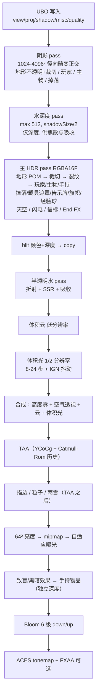
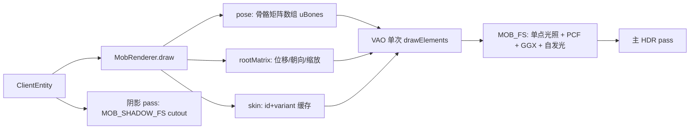

# VoxelCraft（goodPG）案例研究：渲染管线、体积光、洞穴光、POM、天气与生物建模

> 对象：`/home/aa/Proj/mc/goodPG`（`package.json` 名 `voxelcraft`，无引擎依赖，唯一运行时依赖 `gl-matrix`）。
> 技术栈：TypeScript + WebGL2（手写 GLSL，`src/client/engine/gl.ts`）+ 自研 Worker 网格生成 + Cloudflare Worker 服务端。
> 本文所有数字来自代码统计与源码引用；标注 `[INFERENCE]` 的为推断，未实测。

---

## 1. 代码地图

| 层 | 位置 | 规模/职责 |
|---|---|---|
| GL 封装 | `src/client/engine/gl.ts` | Program / RenderTarget / UBO / 全屏三角形 |
| 渲染总控 | `src/client/render/Renderer.ts` | 1264 行，8 阶段管线、UBO 打包、质量预设 |
| 着色器 | `src/client/render/shaders/*.ts` | 12 个模块共 2787 行：terrain / water / post / atmosphere / common / mob / entity / items / particles / clouds / weather / armor |
| 地形网格 | `src/client/world/mesh/mesher.ts` + `worldWorker.ts` | Worker 内 BFS 光照 + AO + 64 位顶点打包 |
| 纹理 | `src/client/textures/*`（85 个文件） | 程序化生成 + CPU mipmap，产出 albedo / normal+height / specular 三个 `TEXTURE_2D_ARRAY` |
| 生物 | `src/shared/mobs.ts` + `render/MobRenderer.ts` + `render/shaders/mob.ts` + 若干 `*Pose.ts` | 声明式盒模型 + 骨骼矩阵 + 程序化贴图 |

运行时开销的“预算表”是先定的：顶点里只留 2 bit AO + 4 bit 天空光 + 4 bit 方块光，所以后文所有光照细节都是在这个预算内做文章。

---

## 2. 总管线（`Renderer.ts:562-880`）



### 2.1 关键决策

| 决策 | 实现 | 原因/代价 |
|---|---|---|
| 相机相对坐标 | 顶点位置减去相机，`uCamPos` 仅还原世界 | 远处不炸 float32 精度 |
| 顶点紧凑打包 | 2×u32：x/z 各 9 bit（1/16 块）、y 13 bit、UV 5+5、纹理层 10 bit、法线 3 bit、AO 2 bit、天空光 4 bit、方块光 4 bit（`mesher.ts:533`） | 带宽极省；光照精度上限被锁定 |
| 单级阴影 + 径向畸变 | `distortShadow`（`SHADOW_DISTORT=0.85`）+ `shadowMagnification`；PCF 为 Vogel 16 点上限、按像素 IGN 旋转、法线 slope-scale 偏移、深度 bias 1.2e-4 | 无级联，用畸变把纹素堆到相机附近；远处阴影软 |
| HDR + 后处理链 | RGBA16F 主缓冲，TAA 带邻域钳制，ACES + 可选 FXAA | 体积光/辉光需要 HDR 余量 |
| 无 G-Buffer | 全前向，唯一“延迟”性的是全屏 post | 简化材质分支；云/体积光/雾都在屏幕空间重算 |

### 2.2 质量预设（`Renderer.ts:87-103`）

| 档 | renderScale | 阴影 | PCF | 体积光步数 | 云步数 | TAA | POM | SSR |
|---|---|---|---|---|---|---|---|---|
| bajo | 0.75 | 1024 / 80 m | 4 | 关 | 18 | 关 | 关 | 0 |
| medio | 1 | 2048 / 112 m | 8 | 12 | 28 | 开 | 关 | 18 |
| alto | 1 | 2048 / 144 m | 12 | 16 | 40 | 开 | 开 | 28 |
| ultra | 1 | 4096 / 192 m | 16 | 24 | 56 | 开 | 开 | 40 |

`NEAR=0.05`、`FAR=1600`（`Renderer.ts:202-203`）；TAA 用 8 个 Halton 序列（`HALTON`）抖动投影矩阵，第 8 位参与 IGN 抖动相位。

---

## 3. 体积光（`shaders/post.ts:104-155`、`Renderer.ts:735-746`）

### 3.1 算法

全屏片元 → 由深度纹理还原视线方向 → 沿视线步进到 `min(sceneDist, 0.95·shadowDistance)`（水下 `0.5×`）：

```glsl
float dt = maxD / steps;
float jitter = uTemporal > 0.5 ? ign(gl_FragCoord.xy) : ignStatic(gl_FragCoord.xy);
for (i < steps) {
  p = rd * ((i + jitter) * dt);
  vis = texture(uShadowMap, shadowCoord(p));   // 1 次阴影采样
  dens = fogDensityAt(y) + 3.5e-4 + rain*2e-3; // 高度雾 + 基础 + 雨
  sum += vis * dens * T * dt;  T *= exp(-dens*dt);
}
col = sum * uLightColor * phase;
col *= under ? 1.0 : mix(0.15, 1.0, eyeSky);
```

- **相位函数**：HG（g=0.78）与各向同性按 0.35 混合；水下 g=0.6、混合 0.4，并乘 `vec3(0.4,0.9,1.0)*3`。
- **水下路径**：用“水面深度图”求水面以下的路径长度 `depthW`，`exp(-(0.35,0.09,0.06)·(depthW+t))` 逐通道吸收。
- **合成位置**：在高度雾/空气透视之后、TAA 之前做加法（`post.ts:248`）。物理上正确（这是“被照亮的雾”），亮柱随后还会吃到 bloom。
- **洞穴抑制**：`eyeSky` 是眼睛位置的天空光 0..1 低通（`cameraRig.ts:46`，1.5/s），地下时整条体积光压到 15%，避免洞里出现太阳光柱。

### 3.2 成本与量化

| 项 | 值 |
|---|---|
| 分辨率 | `ceil(w/2) × ceil(h/2)`（`Renderer.ts:446`），线性上采样 |
| 采样数 | 每像素 `steps` 次阴影采样（8/12/16/24），上限 64 |
| 1280×720 中档 | 230 400 px × 12 ≈ **2.8 M 次阴影采样/帧** [INFERENCE：按代码算术] |
| 降噪手段 | 只有 TAA + IGN 抖动；TAA 关时用静态 IGN（低档直接关闭体积光） |

### 3.3 局限

1. **只有平行光**：散射色乘 `uLightColor`，无视方块光/岩浆/信标 → 火把照亮的洞穴没有体积感。
2. **忽略云影**：地面着色有 `cloudShadow()`，体积光没有 → 云影下仍有全亮光柱。
3. **非深度感知上采样**：1/2 缓冲直接双线性放大，轮廓渗色，靠 TAA 掩盖。
4. **截断**：`maxD` 绑阴影距离（144 m → 137 m），更远的光柱消失。
5. 水下 `depthW` 假设单一水面，多层水/瀑布会高估吸收。

---

## 4. 洞穴光：4 bit 泛洪光照（`mesher.ts`、`terrain.ts`）

### 4.1 数据生产

| 步骤 | 实现 | 备注 |
|---|---|---|
| 工作体积 | 每 chunk 重建时复制 **3×3 列**（`fillVolume`） | 1 chunk 光环 |
| 天空光 | 逐列自顶向下 `light=15`，空气不衰减，遇 `BLOCK_LIGHT_OPACITY` 衰减/清零；被遮柱子的种子入队，6 邻域 BFS 每步 −1 | `computeSkyLight`（`:195`） |
| 方块光 | `BLOCK_EMISSION` 为种子 BFS | `computeBlockLight`（`:271`） |
| 无天空维度 | 天空通道改载“灵魂光”（`soulChannel`，`:130`） | Nether 的青色光照 |
| 每顶点 | 取该角相邻 4 格求平均（跳过不透明格），3 格算 AO（0..3） | `emitFace`（`:467-530`） |
| 四边形翻转 | `ao[0]+ao[2] > ao[1]+ao[3]` 时翻转对角 | 消除 AO 走斜线 |

**1 chunk 光环是充分的**：最大光程 15 块 < 16 块，体积外一格的光不可能越过边界影响本 chunk 的面。

### 4.2 着色（`terrain.ts:429-443`）

```glsl
skyF = s*s*(0.35+0.65*s) * uDim.x;          // 天空光曲线，非线性压暗
amb  = (ambientCube(n)*1.6 + bounce) * skyF; // 6 向辐照度 cubemap + 0.07 地面反弹
blkE = (l*l*3.2 + l*0.35) * (1,0.58,0.28);   // 方块光暖色曲线 + 火焰闪烁
ambient = albedo/PI * (amb + blkE + minAmb) * mix(0.3,1,ao)^2;
diffuse *= mix(0.65,1,ao);                    // 直射光只部分吃 AO
```

- **防太阳漏入洞穴**：直射项乘 `smoothstep(0.2,0.55,vLight.x)`（`terrain.ts:405`）。单级阴影在深洞够不到地表，只能由天空光通道否决直射。
- **绝不纯黑**：`minAmbient()` = 0.012（`common.ts:52`）。
- **大洞穴不露“天空”**：合成阶段 `farC = mix(fogCol, skyC, eyeSky)`，地下时远景融进暗雾。
- **Deep Dark**：孢子粒子 + `effectView` 的致盲/黑暗视效。

### 4.3 局限

1. 4 bit → 15 级，大面积墙面有马赫带；没有光照抖动（IGN 只用于阴影/体积光/云）。
2. 没有 SSAO/接触阴影；实体只按单点 `lightAt()` 取光。
3. 方块光只有暖色 ramp，无颜色信息（灵魂光是特例）。
4. 每次 remesh 重跑整个 3×3 体积的两次 BFS，火把密集区编辑吃 CPU。

---

## 5. POM（`terrain.ts:315-341`、`texCore.ts:553-625`）

### 5.1 数据链路

| 阶段 | 内容 |
|---|---|
| 美术侧 | `Tex.height` 浮点高度场；`Tex.depth` 控制法线陡度 |
| 烘焙 | 高度平移到最大值恰为 1；Sobel 求梯度 → `normal.rg`；**归一化高度写 `normal.a`**；透明像素 `(128,128,255,0)` |
| 上传 | `TEXTURE_2D_ARRAY` RGBA8，CPU 生成 mipmap（保留裁切 alpha） |

### 5.2 算法

```glsl
if (uPom > 0.5 && !plant && special == 0 && viewDist < 18.0) {
  Vt = (V·T, V·B, V·N);
  if (Vt.z > 0.05) {
    scale = 0.07 * (1 - smoothstep(12, 18, dist));
    P = (Vt.x, -Vt.y) / max(Vt.z, 0.3) * scale;
    // 20 步线性步进，沿 -P 推进 uv，直到累计深度 >= 1 - height
  }
}
```

- 步长 `0.0035 UV`；位移预算 `0.07 UV` = **1.12 texel**（16 px 贴图），即“浅浮雕”。
- 用 `textureGrad` + 原始 UV 的导数（`gdx/gdy`）保证 mip 稳定；`pixelArtUVw` 的 AA 带宽保住亚纹素位移。
- 只在不透明 pass（`#ifndef CUTOUT`），排除植物、岩浆、火焰、End 门。

### 5.3 局限

| 问题 | 影响 |
|---|---|
| 20 步 vs 1.12 texel 位移预算 | 严重过采样：地形最贵的单像素路径，6 步 + 1-2 次细化即可 |
| `scale` 是常数 | 不读每张纹理的 `depth`，圆石与玻璃浮雕强度相同 |
| 不写深度/不影响阴影 | 无自遮挡、无轮廓变化，光柱阴影里看不到浮雕 |
| 掠射角 | `max(Vt.z,0.3)` 截断避免爆散，代价是边缘位移饱和、像贴纸 |
| 仅 high/ultra | medio 及以下完全关闭 |

---

## 6. 天气系统

### 6.1 模型：确定性函数（`shared/weather.ts`）

```ts
rainAt(worldTime, seed): 0..1     // 周期 0.35 天；hash2(k,7331,seed) < 0.2 才下雨
thunderAt(worldTime, seed): 0..1  // 1/3 的降雨是雷暴，且只在 rain > 0.45 时
```

客户端与服务端调用同一函数，无状态、无消息。季节式渐入渐出用 smoothstep（`0→0.08` 与 `0.9→1` 两段）。

| 参数 | 值 |
|---|---|
| 周期 | 0.35 天 |
| 出现概率 | 每 5 个周期 1 次下雨 |
| 强度范围 | `0.65 + 0.35·hash` |
| 雷暴概率 | 降雨的 1/3，且 `rain > 0.45` |
| 落雷速率 | `1/9` 次/秒/玩家 × thunder 强度（`sim/server/storms.ts`） |
| 调试覆盖 | `window.__rain`、`window.__cloudCov` |

### 6.2 降水渲染（`render/Weather.ts` + `shaders/weather.ts`）

| 项 | 值 |
|---|---|
| 实例数 | 9000（一次 `drawArraysInstanced(TRIANGLE_STRIP, 0, 4, 9000)`） |
| 包围盒 | 36 × 28 × 36，随相机取模包裹 |
| 每实例数据 | 1 个 `vec4` 随机种子（`divisor=1`） |
| 稀疏化 | `aSeed.w > uIntensity` 丢到裁剪空间（强度＝整滴增减，另乘 alpha） |
| 下落速度 | 雨 11–15 m/s；雪 1.4–2.0 m/s |
| 风 | `(1.2, 0.5)`；雪再叠两路正余弦摆动 |
| 广告牌 | 雨：`fall × toCam` 得侧向量，长 0.75、宽 0.018；雪：面向相机 0.07 方块 |
| 屋顶遮挡 | 64×64 `R32F` 高度图，`texelFetch` 取列最高非植物/非火把方块，`world.y < top+1` 丢弃 |
| 高度图刷新 | 每 0.5 s 重扫 4096 列（仅 `rain > 0.01` 时），覆盖玩家 ±32 块 |
| 绘制时机 | TAA **之后**、曝光/泛光之前 → 雨丝不留 TAA 残影 |
| 片元 | 纯几何形状 × 地平线辐照度；alpha 雨 0.28 / 雪 0.85；颜色“永远比背景亮一点” |

### 6.3 天气对其他系统的副作用

| 位置 | 效果 |
|---|---|
| `Renderer.computeLights` | 直射光 `×(1 − 0.82·rain)`：阴天太阳暗 82%，光柱随之消失 |
| `terrain.ts:355-372` | 湿润：暴露面压暗 albedo（最多 50%）、抬高 smoothness；`uCloudWeather` 噪声出**水洼**（smoothness→0.97、法线拉平） |
| `water.ts:79` | 水面波纹 `×(1 + rain·3)` |
| `environment.sky` | 云量逼近 0.86、雾 `+0.006·rain` |
| `post.ts:143` | 体积光密度 `+0.002·rain` |
| `atmosphere.ts:370` | 太阳圆面 `×(1 − rain)` |
| 曝光 | `uEV = brightness − 0.7·rain + 2.5·nightVision` |
| `ambientParticles.rain()` | 溅落粒子：`min(12, 45·I·dt)`/帧，玩家 ±10 块内自上而下找首个固/液/叶方块；寒冷/高山跳过 |
| `effects.ts:45-62` | 闪电：白屏 flash（按 `eyeSky` 衰减，洞里不闪）、屏幕抖动、雷声延迟 |
| `sim/server/storms.ts` | 落雷：`skyTop` 定位、避雷针改道、5 点伤害、点燃 3 块、广播 `fx: lightning` |
| `redstone/farming/fire/cauldrons/nature` | 日照传感器、耕地湿润、雨灭火、炼药锅接雨、雪线迁徙 |
| `equipmentInteraction.ts:224` | 雨中暴露判定（打火石点不着等） |

### 6.4 音频

| 层 | 实现 |
|---|---|
| 常驻雨声 | 白噪声 → 带通 3500 Hz Q0.5 → 增益 `0.5·rain`（`ambience.ts:95-104,144`） |
| 离散雨滴 | 间隔 `(2.5 − 2.42·rain)·rand(0.7,1.3)` s，强度 <0.02 时 0.4 s |
| 雷声 | `playThunder(distance, sky)`：延迟 `distance/343`（≤4 s），音量随距离与 `sky`；地下只剩低频隆隆 |
| 雪 | 音频雨量置 0（`Game.ts:1011`） |

### 6.5 局限

1. 屋顶图只覆盖 ±32 块、2 Hz 刷新、`NEAREST`：快跑时会“追上雨”，图外的雨无遮挡。
2. 水洼是噪声图案，不写真实水面高度：走上去没有水花、无反射翻倍。
3. 雪不积雪（只有温度/高度层面的雪线）。
4. 雨 alpha 0.28，暗夜里雨丝偏灰；稀疏化是整滴消失，低强度可能有闪断。
5. 雷暴与体积光不联动：闪电瞬间没有额外光脉冲（`flash` 值已存在，可直接接进 `uLightColor`）。

---

## 7. 生物建模

### 7.1 规模统计（从 `MOBS` 表实测）

| 指标 | 值 |
|---|---|
| 生物定义数 | 82（81 个有盒模型 + 1 个自定义模型 `ender_dragon`） |
| 模型部件总数 | 750 |
| 每生物平均部件 | 9.3 |
| 最多部件 | 22（`guardian` / `elder_guardian`；其次 `pufferfish` 17、马 15） |
| 骨骼层级深度 | 1 层 22 个、2 层 35 个、3 层 20 个、4 层 1 个、5 层 3 个 |
| 骨骼上限 | `MAX_BONES = 24`（`shaders/mob.ts`） |
| 顶点数上限 | 每部件 24 顶点 / 36 索引（6 面 × 4 顶点） |
| 图集尺寸 | 256×256 ×1、128×128 ×2、128×96 ×1、128×64 ×13、64×128 ×5、64×96 / 72 各 1、64×64 ×30、64×48 ×3、64×32 ×11、64×16 ×2、32×32 ×7、32×16 ×5 |
| 图集总纹素 | ≈ 435 200 |
| UV 复用 | 平均 73% 部件唯一（最低 15%，腿/爪共用 UV 只画一次） |

### 7.2 模型声明（`shared/mobs.ts`）

```ts
interface ModelPart {
  name; parent?;            // 骨骼父子关系
  pivot: [x,y,z];           // 相对实体原点（或父骨骼），像素
  from: [x,y,z];            // 相对 pivot 的盒角
  size: [w,h,d];            // 盒子尺寸，像素
  uv: [u,v];                // 盒展开的图集起点（Minecraft 布局）
  rot?; grow?;              // 静止旋转；CubeDeformation
}
```

- 单位：1 像素 = 1/16 块（`P = 1/16`）。
- `boxFaces(u,v,w,h,d)` 按 Minecraft 布局给 6 个面的 UV 矩形：`[+X, -X, 顶, 底, 前(-Z), 后(+Z)]`。
- 变体：`atlas` + 纹理变体（马/羊驼毛色、村民职业、鹦鹉色、猫皮…），同骨架不同贴图。

### 7.3 网格构建（`MobRenderer.mesh()`）

| 项 | 实现 |
|---|---|
| 缓存 | 每物种 1 个 VAO（`meshes`），装备层另有膨胀版（`gearMeshes`，键 = `id*1000 + inflate*100`） |
| 属性 | 位置 vec3、法线 vec3、UV vec2（按图集归一化）、骨骼索引 float |
| 索引 | `Uint16`；每盒 24 顶点 / 36 索引 |
| 膨胀 | 装备/光晕用 `inflate`，`grow` 支持单部件向四周长半个像素且不改 UV |
| 绘制 | **每生物一次 `drawElements`**（+可选光晕、+可选装备层）；VAO/贴图切换在生物之间 |

### 7.4 动画系统

| 层 | 模块 | 职责 |
|---|---|---|
| 全局调度 | `MobRenderer.pose()`（`:285`） | 遍历部件 → 父子矩阵 → 静止旋转 → 逐部件动画 → 隐藏/缩放 |
| 通用 | `MobRenderer.animate()`（`:183`） | 先给外部模块机会（Nether/Wither/载具/fauna/guardian/critter/allay），再按 `def.anim` 走内建 switch |
| 内建 anim | `quadruped`(21)、`zombie`(4)、`fish`(3)、`slime`(3)、`flyer`(3)、`illager`(3)、`piglin`(3)、`magma`(3)、`skeleton`(2)、`spider`(2)、`squid`(2)、`villager`(2)、`golem`(2)、`guardian`(2)、`hoglin`(2) + 21 个单例 | 行走摆动、头部朝向（`clampAngle(yaw-bodyYaw, 1.3)`）、攻击姿态 |
| 专用 | `monsterAnim.ts`、`illagerAnim.ts`、`wardenAnim.ts`、`aquaticPose.ts`、`netherMobPose.ts`、`faunaPose.ts`、`guardianPose.ts`、`critterPose.ts`、`allayPose.ts`、`shulkerPose.ts`、`witherPose.ts`、`vehicleModels.ts`、`mountPose.ts`、`companionPose.ts` | 翅膀拍打频率、蜘蛛腿相位、鱿鱼倾斜、潜影贝开合、Wither 尾巴、Boats 划桨等 |
| 根变换 | `rootMatrix()`（`:320`） | 相机相对平移 → `bodyYaw` → 死亡侧倒 → 骑乘/水生/召唤根姿态 → 缩放（幼体 ×0.5、Wither 出生） |
| 手部挂点 | `handMatrix()` / `netherHandMatrix()` | 从骨骼矩阵取 `armR` 再平移到指尖，供物品/弓/三叉戟/Alay 持有物 |

细节：隐藏部件不用 0 缩放（矩阵奇异会画出穿屏线），统一 `HIDE = 1e-3`（`MobRenderer.ts:57`）。

### 7.5 纹理管线（`textures/mobTextures.ts` + 各 `*Textures.ts`）

| 阶段 | 内容 |
|---|---|
| 入口 | `generateMobTexture(id, variant)`：fauna → critter → nether → 村民 → `VARIANT_PAINTERS` / `PAINTERS` / `MONSTER` / `ILLAGER` / `OCEAN` / `ALLAY` / `WARDEN` |
| 绘制模型 | 每个 painter 给出“3D 位置 → 颜色”的映射（`paintMob` 遍历每部件 6 面每纹素，用与 `buildBox` 相同的角约定算出盒上的 `(x,y,z)`）→ 图案跨面连续（奶牛斑点、苦力怕迷彩、羊毛） |
| 去重 | `Set<uv,size>`：共用 UV 的部件只画一次 |
| 特殊通道 | `alpha 255` 不透明；`alpha 128–250` = **自发光**（蜘蛛/末影人眼睛）；`alpha 0` = 未使用/裁切 |
| 上传 | `RGBA8`、`NEAREST`、`CLAMP_TO_EDGE`；按 `(id, variant)` 缓存，无 mipmap（像素风） |
| 失败回退 | `placeholderTexture()`：平色 + 轻微噪声，保证缺纹理不崩 |

### 7.6 着色（`shaders/mob.ts`）

| 项 | 实现 |
|---|---|
| 照明 | 每生物 1 次 `lightAt(e.x, e.y+0.6, e.z)` → `(sky, block)`；`ambientCube` 去饱和 45%（白羊毛不变蓝） |
| 阴影 | PCF 半径 1.5；`cloudShadow` 同样作用于生物 |
| 高光 | GGX，`rough=0.75`、`f0=0.04`（各向同性近似） |
| 受击 | `uTint = (1, 0.45, 0.45)`；苦力怕引信 `uFlash` 白闪 |
| 自发光 | 贴图 alpha 阈值 → `col = max(col, albedo*2.5)`；`fullBright` 生物（烈焰人/岩浆怪）直接 `(0,1)` |
| 强隐 | `EF_INVISIBLE` 跳过本体，但保留装备/光晕层 |
| 溶解 | 龙死亡：`floor(uv*256)` 哈希阈值丢弃 + 边缘紫色 `vec3(3.0,1.2,3.6)` |
| 阴影 pass | `MOB_SHADOW_*`：同骨骼矩阵，按皮肤 alpha 做 cutout |

### 7.7 生物渲染路径小结



### 7.8 局限

1. 每生物 1–3 次 draw call，**无实例化**：同屏 50 只生物（如僵尸围攻）就是 50–150 次绘制；可合并同物种的实例矩阵。
2. 光照是单点采样：没有每部件光照、没有 AO，贴近地面/墙面的脚部与环境脱节。
3. 骨骼上限 24，新增物种必须拆分或降部件；层次最深的 5 层链条在 `mat4` 递归里成本可忽略，但调试难。
4. 动画全是解析式正弦 + 相位，无状态机混合（例如“边走边攻击”只靠叠加角度），极端参数下会互相打架。
5. 纹理是程序化 painter，变体多了以后图集尺寸/生成时间线性上升；`128×128` 的 ravager/warden 是当前上限。
6. 龙是唯一的自定义模型（`DragonRenderer`），与其他 81 个物种两条代码路径。

---

## 8. 共性问题与改进优先级

| 优先级 | 问题 | 具体改法 | 预期收益 |
|---|---|---|---|
| 1 | 方块光无体积散射 | 每 chunk 存 4³ 降采样方块光网格；体积光加第二段 `sumBlock`（或最亮 4 光源解析积分） | 洞穴/火把房间出现体积光，观感提升最大 |
| 2 | 体积光忽略云影 | 每步或首命中点乘 `cloudShadow()` | 消除“云影下的光柱”，物理自洽 |
| 3 | 光照 15 级马赫带 | `skyLightCurve`/`blockLightColor` 前加 `ign()` 抖动（`1/15` 量级） | 近乎零成本的画质提升 |
| 4 | POM 20 步过采样 | 6 步 + 1–2 次割线细化；`scale` 读 `layerProps.depth` | 省下的 ALU 换 PCF/阴影分辨率 |
| 5 | 体积光非深度感知上采样 | 4-tap 双边上采样（按深度容差） | 消除轮廓渗色，TAA 关时也能用 |
| 6 | 生物无实例化 | 同物种合并实例矩阵/骨骼纹理（或 `gl_InstanceID` + 骨骼纹理） | 大群生物 CPU/驱动开销下降 |
| 7 | 天气高度图覆盖小 | 覆盖改 96×96 或按速度扩展；或 4 Hz 增量更新 | 快速移动时雨区稳定 |

### 验证方式（复现本文结论）

```bash
pnpm dev                       # 5173，含 Worker
pnpm build                     # 静态托管到 /goodPG/
# 游戏内：F3 看 HUD（Seed / Draw calls / 队列 / Chunks / Mob / XYZB / sim ms）
# 天气：[1] 控制台 __rain = 1，__cloudCov = 0.9
# 画质：设置里切 bajo/medio/alto/ultra，对比体积光与 POM
```

`pnpm typecheck` 覆盖客户端/服务端/测试三套 tsconfig；`pnpm test` 为 `tsx --test tests/*.test.ts`（此前存在 4 处既有失败，均与渲染无关；以实际运行结果为准）。
