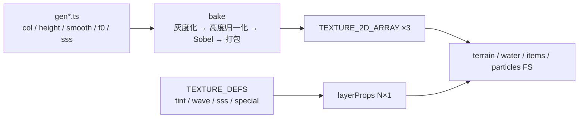

# VoxelCraft（goodPG）GL 专题：草地顶面、雪、树叶、水下、天气与材质预设

> 对象：`/home/aa/Proj/mc/goodPG`（`voxelcraft`，WebGL2 + 手写 GLSL）。
> 本文只拆你点名的六处：**草方块顶面、雪（视差贴图资源）、树叶、水下（含粒子）、天气、冰/铜等预设方块**。
> 行号以当前工作树为准；`[INFERENCE]` 表示由代码算术得出、未做 GPU 计时。

---

## 0. 这六处共用的一套底座

它们不是六个独立特效，而是同一套“**每层 4 字节属性 + 每纹素 4 通道 PBR + 一次打包顶点**”的不同取值。先看底座，后面每个效果只是填了不同的表。

### 0.1 纹理：3 个 `TEXTURE_2D_ARRAY` + 1 条属性纹理

| 资源 | 格式 | 通道语义 | 位置 |
|---|---|---|---|
| `uAlbedo` | `SRGB8_ALPHA8`（硬件解码到线性） | RGB 反照率，A = 裁切/染色蒙版 | `BlockTextures.ts:113` |
| `uNormalTex` | `RGBA8` | RG = 切线空间法线 XY，B = 法线 Z，**A = 归一化高度** | `BlockTextures.ts:114`、`texCore.ts:605-610` |
| `uSpecular` | `RGBA8` | R = 感知平滑度，G = **F0（≥230 视为金属）**，B = 次表面散射，A = 自发光 | `BlockTextures.ts:115`、`generateTextures.ts:8-14` |
| `uLayerProps` | `RGBA8`，N×1，`NEAREST` | 每层的 `tint / wave / sss / special` | `BlockTextures.ts:117-132` |

实测规模（`TEXTURE_DEFS.length`）：**1010 层**、16×16/层；单数组 1.03 MB，三数组原始 2.96 MiB，含 mip 约 **3.9 MiB** `[INFERENCE: ×4/3]`。这已经超过 WebGL2 保证的 256 层，`BlockTextures.ts:139-141` 只做 `console.error` 而继续上传——桌面卡通常 2048 层，移动端会直接失败。这是“加方块 = 加一行定义”的代价上限。

`uLayerProps` 在**顶点着色器**里 `texelFetch`（`terrain.ts:33`），所以 fragment 侧拿到的是 `flat` 属性，没有逐像素查表；`special` 因此可以放心当整像素分支用。

### 0.2 顶点：2×u32，UV 只有 5 bit

`mesher.ts:532-533` 把位置、UV、层号、法线、AO、天空光、方块光全塞进两个 `u32`：

- UV 5+5 bit，解码为 `值/16` → 16 px 纹理正好落在**纹素角点**（0..1 共 16 档），POM 偏移前没有插值误差。
- 层号 9+1 bit（`layer & 511` + `layer >> 9` 存进 x 的最高位），因此上限 1024 层，和 1010 的实测值只差 14 层——再加方块就得先改布局。
- 风摆放在**顶点着色器**（`terrain.ts:37-57`），逐帧改的是 `uWind`，CPU 不碰网格。

### 0.3 采样：`pixelArtUVw` + `textureGrad`

```glsl
// common.ts:119-124
vec2 pixelArtUVw(vec2 uv, float size, vec2 w) {
  vec2 p = uv * size;
  vec2 seam = floor(p + 0.5);
  p = seam + clamp((p - seam) / w, -0.5, 0.5);   // 放大时保持硬边，缩小时按 fwidth 渐变
  return p / size;
}
```

纹理是 `MAG=NEAREST`、`MIN=LINEAR_MIPMAP_LINEAR`、各向异性 8（`BlockTextures.ts:164-170`）。`pixelArtUVw` 存在的原因是注释里写的 ANGLE/D3D11 行为：开各向异性后 `MAG=NEAREST` 会被忽略，所以像素风必须在着色器里自己做。所有地形/水/物品采样都用 `textureGrad(..., gdx, gdy)`，让 POM 位移后仍走正确的 mip 与各向异性。



---

## 1. 草方块顶面：POM + 生物群系染色

### 1.1 资源生成（`textures/genSoil.ts:109-149`）

```ts
const v = field((x,y,i) => 0.42*n4.at(x,y) + 0.33*n8.at(x,y) + 0.25*px[i]);
const lv = rankLevels(v, [6, 14, 24, 26, 18, 12]);        // 6 档，中段最多
t.height[i] = 0.6 + 0.3 * (lv[i] / 5);                    // 0.6..0.9
t.smooth[i] = 38 + 3*lv[i];  t.sss[i] = 30;
// 22 条 2 px 亮草叶：height = 1，smooth = 55
// 16 个暗斑：height = 0.45
t.depth = 1.0;
```

要点：

1. **高度不是“随便加噪声”**：底色高度 0.6–0.9，草叶尖是 1.0，暗斑是 0.45。归一化后（`texCore.ts:551-556`）最高点恰为 1，于是 POM 的深度范围由“草叶 vs 暗斑”的 0.55 决定，视觉上是“草叶浮在土上”。
2. **灰度化后才染色**：`grass_top` 定义 `tint: 1`（`textureDefs.ts:46`），`bake` 把 RGB 换成 Rec.709 灰度（`texCore.ts:541-549`），运行时再乘群系颜色。
3. **法线由 Sobel 从高度求**（`texCore.ts:592-604`），高度同时写进 `normal.a`（`:610`），所以**一份数据供两个效果**：POM 用它步进，光照用法线。

### 1.2 POM（`terrain.ts:314-339`）

```glsl
if (uPom > 0.5 && !plant && special == 0 && viewDist < 18.0) {
  vec3 Vt = vec3(dot(V0,T), dot(V0,B), dot(V0,N));
  if (Vt.z > 0.05) {
    const int STEPS = 20;
    float scale = 0.07 * (1.0 - smoothstep(12.0, 18.0, viewDist));
    vec2 P = vec2(Vt.x, -Vt.y) / max(Vt.z, 0.3) * scale;
    float d = 1.0 - textureGrad(uNormalTex, vec3(pixelArtUVw(cuv,16.0,fw), lay), gdx, gdy).a;
    for (int i=0;i<STEPS;i++) { if (cur >= d) break; cuv -= delta; cur += layerD; d = ...; }
    uv = cuv;
  }
}
```

- 预算：`scale = 0.07 UV` = **1.12 texel**（16 px 贴图），所以这是“浅浮雕”，不是视差墙。
- 12–18 m 内线性淡出 `scale`，18 m 外直接关闭，避免远处高频取样闪烁。
- 只在不透明通道：`#ifndef CUTOUT`（`:314`），因此草顶/雪/石/木都有，**树叶和植物永远没有 POM**（见 §3）。
- 掠射角用 `max(Vt.z, 0.3)` 截断，防止位移爆散；代价是侧看时草叶会“贴纸化”。
- 采样用 `pixelArtUVw` + 固定 `fw`（`fwidth(uv*16)`，`terrain.ts:310`），保证位移后不糊。
- 开关在质量预设：`pom` 仅 `alto/ultra` 为真（`Renderer.ts:87-103`），`uPom` 在 `Renderer.ts:682` 传入。

成本：每像素最多 20 次 `textureGrad` + 循环。1080p 下若 40% 像素在 18 m 内，约 **1660 万次法线取样/帧** `[INFERENCE: 2.07M×0.4×20]`。这是地形最贵的单像素路径。

### 1.3 染色与光照

- 顶点阶段 `vBiome = textureLod(uBiomeMap, world.xz/1024, 0)`（`terrain.ts:87`），一张 256² 的 `SRGB8_ALPHA8` 图覆盖 1024 块（4 块/texel，`TerrainRenderer.ts:34,147-155`）。
- 三种染色：`1` 整体乘，`2` 只乘 alpha=255 的像素（草方块侧面，`textureDefs.ts:47`），`3` 乘并压成偏黄的植被色（`:350`）。
- 着色仍走统一 PBR：`rough = max((1-smooth)², 0.03)`、`sss = max(sp.b, vProps.b)`、环境项 `albedo/PI*(amb+blockE+minAmb)*ao²`（`terrain.ts:369-373,438`）。草顶 smoothness 38–55（0.15–0.22）→ `rough ≈ 0.61–0.72`，所以草面只有很宽的弱高光，不会像塑料。

**为什么好看**：高度场的高频（草叶/暗斑）在 POM 里产生真实的逐像素遮挡与轮廓位移；法线负责光影；群系染色负责大色块。三者互不重复，且共用一份高度数据。

### 1.4 局限

1. `scale` 是常数 0.07，**不读每层的 `depth`**（`t.depth` 只影响 Sobel 的法线陡度，`texCore.ts:603-604`）。圆石和草顶的浮雕强度必然相同。
2. 20 步对 1.12 texel 是严重过采样：6 步 + 2 次割线细化足够。
3. 不写深度、不进阴影：光柱/阴影里看不到草叶轮廓。
4. 仅 high/ultra 开启，medio 及以下草顶又变回平面。
5. 顶点 UV 只有 5 bit、层号只有 10 bit（`mesher.ts:532-533`）：1010 层已接近上限，POM 的 UV 精度也就锁死在 1/16。

---

## 2. 雪：同一套 POM，换成“高亮度 + 高散射 + 浅浮雕”

### 2.1 资源（`textures/genSoil.ts:219-247`）

```ts
SNOW = [[224,231,241],[233,239,246],[241,245,250],[248,250,253]];
t.height[i] = 0.75 + 0.25 * n4.at(x,y);   // 比草顶浅得多
t.smooth[i] = 70 + 6*lv[i];               // 70..88
t.sss[i] = 120;                           // 120/255=0.47，草顶只有 30/255=0.12
// 5 个晶体高光点：近白，smooth = 180
t.depth = 0.9;
```

- 定义 `{ name:'snow', sss:0.25 }`（`textureDefs.ts:49`）；逐纹素 120 会盖过它（`sss = max(sp.b, vProps.b/255)`，`terrain.ts:372`）。
- 高度范围 0.75–1：POM 的深度只有 0.25，所以雪面的视差是**细微的起伏**，不是草叶那种尖刺；配合 smoothness 70–88（0.27–0.35，rough≈0.43–0.53），高光是一条宽亮带。
- 5 个 `smooth=180` 的点就是“雪粒闪光”：在太阳下走位时，这些点会单独出高光。
- 雪的“软”主要来自 `sss`（`:423-427`）：

```glsl
float back = pow(saturate(dot(V, -L)), 5.0);
trans = albedo * sss * lightCol * (0.18 + 1.6 * back) / PI;
```

这意味着雪在逆光时边缘会亮起来；`sss` 是全向的 0.18 底 + 逆光 1.6 的峰。

### 2.2 雪地变体

- `grass_side_snowy`（`textureDefs.ts:48`，生成 `genSoil.ts:191-217`）：`dirtBase` 上叠 3–5 px 雪檐，`fringeDepths` 做不规则下沿，`smooth=84`、`sss=120`，雪-土交界处压暗 0.78。它是**不透**方块，所以进 POM，侧面看雪檐有厚度。
- `powder_snow` 只给了 `sss:0.3`（`textureDefs.ts:380`），没有 POM 特判——细雪粉的观感靠 `sss` 与白色 albedo。

### 2.3 局限

1. 雪的高光点写死在 16×16 纹理里，不随视角“闪”，只是静态亮点。
2. `sss` 是标量，雪和树叶用同一条曲线，不能给雪更宽的“前向散射”。
3. `depth=0.9` 与草顶 `1.0` 只影响法线，不影响 POM 位移。
4. 没有积雪层/脚印/风吹雪面高度变化（雪层方块是另一套几何）。

---

## 3. 树叶：裁切 + 风 + 透光 + 落叶

树叶好看不是因为 POM（恰恰没有），而是四件事叠在一起。

### 3.1 纹理：洞、边、光（`textures/genWood.ts:399-497`）

```ts
// 1) 30% 洞：泊松盘撒点 + 每点 2–5 px 的紧凑团块，再补孤立单点（:414-442）
// 2) 到洞的距离场（:444）→ 越靠边越亮/越透
t.height[i] = 0.4 + 0.6*smoothstep(0,2.5,dist[i]) + 0.08*(n8.at(x,y)-0.5);
t.sss[i]    = 200 + 55*(1 - smoothstep(1,3,dist[i]));   // 0.78..1.0
// 3) 上边缘 +1 档、下边缘 -1 档（:469-471）
// 4) 12 处 2 px 亮尖（:473-482）；针叶则是 22 条斜向亮/暗线（:483-495）
t.depth = 1.3;
```

- `oak_leaves` 定义：`tint:3, wave:1, sss:0.85, cutout:true`（`textureDefs.ts:62`）。灰度图 → 群系植被色。
- 洞用 `alpha=0`，`bake` 会把洞内 RGB/法线/平滑度用邻域**膨胀**（`texCore.ts:465-520` 的 `bleed`），避免 mipmap 时出现黑边。

### 3.2 风（`terrain.ts:37-57`）

```glsl
float strength = uWind.z * smoothstep(0.35, 0.9, v.sky) * uDim.x;
if (wave < 1.5) {                       // 树叶：wave = 1
  float ph = world.x*0.7 + world.z*0.45 + world.y*0.35;
  return vec3(sin(t*1.7+ph)*0.045, sin(t*2.3+ph*1.3)*0.02, cos(t*1.4+ph*0.9)*0.045) * strength;
}
```

关键设计：**相位只由世界坐标决定**，所以相邻方块、同一方块的四个角都连续，不会出现“每块各摆各的”的裂缝；由于相位逐顶点不同，方块会轻微剪切而不是整体平移。`strength` 再乘天光（`v.sky`），树冠内部几乎不动，只有顶层在风里。`uWind.z = 1 + rain*1.5`（`Renderer.ts:532`），下雨时风更大。

### 3.3 裁切、阴影与透光

- 不透明与裁切是**两个 program**：`pTerrain` / `pTerrainCut`，后者带 `defines:{CUTOUT:true}`（`Renderer.ts:334-335,682-685`）。裁切里 `if (alb.a < 0.5) discard`（`terrain.ts:342-344`）。
- 树叶在阴影 pass 也走裁切（`SHADOW_FS`，`terrain.ts:481-491`），所以树冠会投下**带孔的光斑**，而不是整块黑。
- 透光项用同一 `sss`（`:423-427`）：叶缘 `sss≈1` 逆光最亮，叶心 `0.78` 较暗，形成“薄处透光”的错觉。
- 法线贴图照常生效（`:352-354`），但 POM 被 `#ifndef CUTOUT` 排除，叶子不会把邻接像素“挖”出来。

### 3.4 落叶粒子（`ambientParticles.ts:124-134`）

```ts
if (isLeaves(b)) {
  const below = world.getBlock(x, y-1, z);
  if (below !== 0) continue;                          // 只在树冠底面掉
  if (b === CHERRY_LEAVES) { if (Math.random()<0.16) fx.petal(...); }
  else if (Math.random()<0.006) fx.leaf(x, y-0.05, z, r, g, b);
}
```

`leaf()`（`effects.ts:92-99`）用 `PF.COLLIDE|FLUTTER|REST|FADE_IN`：`FLUTTER` 在 `ParticleSystem.ts:258-263` 加侧向摆动并让旋转跟随，`REST` 落地后静止 2.5–4.5 s 再淡出。颜色由 `leafColor()`（`ambientParticles.ts:242-247`）取群系色或固定树种色。

### 3.5 局限

1. 裁切只有二值 `discard`，TAA 下树叶边缘会闪；没有 alpha-to-coverage / 覆盖率抖动。
2. 风是刚性剪切，没有“叶片单独翻面”；强风时树冠会像一整块布。
3. 没有 POM（被 `#ifndef CUTOUT` 排除），叶面没有自遮挡感。
4. 落叶只在树冠底面、半径 12 块内采样（`SCAN_R=12`，`ambientParticles.ts:27`），远处树的落叶看不见。

---

## 4. 水下：光、水面、焦散、体积光、屏幕、粒子

水下的“好”来自六层各自成立、且共用同一组量：`uMisc.z`（是否在水下）、`uLightColor.w`（太阳透水系数）、`uWaterShadow`（水面深度）。

### 4.1 透水光：`waterLight`

```ts
// cameraRig.ts:50-60
let y = floor(eyeY), depth = 0;
for (; depth < 64; depth++, y++) {            // 沿垂直列向上找水面
  const b = world.getBlock(ex, y, ez);
  if (b <= 0 || BLOCK_FLUID[b] !== 1) break;
}
if (world.getBlock(ex, y, ez) === AIR && world.getLight(ex, y, ez) >> 4 >= 14)
  waterLight = Math.exp(-0.07 * depth);       // 只有“上方见天”才算
```

结果写进 `uLightColor.w`（`Renderer.ts:524`），所有材质共用：

```glsl
// common.ts:57-61
vec3 underwaterLight(vec3 skyUp) {
  return (uLightColor.rgb * max(uLightDir.y,0.0) * 0.45 + skyUp * 0.8)
       * vec3(0.3, 0.8, 0.95) * uLightColor.w;
}
```

粒子（`particles.ts:108`）和手持物（`items.ts:102`）都加这一项。**这是水下粒子不黑的关键**：方块天空光在水下几格内就衰减到 0，如果粒子只读天空光，深水会变成黑点。

### 4.2 水面：折射 + Beer-Lambert + SSR + 全反射 + 泡沫（`water.ts`）

| 步骤 | 实现 | 行（均指 `water.ts`） |
|---|---|---|
| 波浪 | 顶点高度 3 组正弦，仅水面顶面（`fract(y)≈0.875`） | `water.ts:21-25` |
| 法线 | 4 层 256² 程序化法线图，不同尺度/流速叠加；`strength` 随距离 0.55→0.18 | `water.ts:74-81`、生成 `:252-296` |
| 折射 | 拷贝场景色+深度，按法线偏移 UV；若偏移后深度在表面前则回退 | `:158-167` |
| 厚度 | `thickness = (sceneLin - surfLin) * dist/surfLin` | `:169` |
| 吸收/散射 | `exp(-absorb*thickness)` + `scatterAlb*inLight`，暖水/冷水两套系数 | `:181-190` |
| SSR | 0–64 步（质量预设），命中后 6 次二分；边缘淡出 | `:88-122` |
| 菲涅尔/全反射 | 水面 Schlick F0=0.02；从水下看用 n=1.33 的临界角近似 | `:199-205` |
| 高光/泡沫 | GGX rough 0.08；岸边按 `thickness` 与法线图蓝通道出泡沫 | `:205-213` |

水面 pass 在 HDR 主通道之后、TAA 之前（`Renderer.ts:713-726`），用拷贝的颜色/深度做折射；水的深度单独渲染成 `uWaterShadow`（`Renderer.ts:642-647`，`max(512, shadowSize/2)`，只写深度），供焦散和体积光用。

### 4.3 焦散（`terrain.ts:139-160,405-415`）

```glsl
float waterDepthToLight(vec4 sc) {
  float wd = texture(uWaterShadow, sc.xy).r;
  float diff = sc.z - wd;
  return diff > 0.0004 ? diff * 2.0 * 256.0 : 0.0;  // 世界单位：水面到该点的距离
}
...
float wd = waterDepthToLight(sc);
vec3 absorb = exp(-vec3(0.35,0.09,0.06) * wd);
float c = caustics(vWorld.xz*0.55 + vWorld.y*0.1, uWind.w*0.9);
lightCol *= absorb * (0.45 + 1.6 * c * exp(-wd*0.08));
```

- `caustics` 是 4 次迭代的正弦/余弦链（`:148-160`），不是噪声图，所以无采样成本、无 tiling。
- 只作用于**直射项**（`lightCol`），且只在 `shadow > 0` 的分支里（`:406`），洞穴/室内不会莫名其妙出现水纹。
- 深水自动压暗并衰减焦散对比度。

### 4.4 体积光在水下（`post.ts:119-152`）

```glsl
bool under = uMisc.z > 0.5;
float maxD = min(dist, uShadowOffset.w * (under ? 0.5 : 0.95));
...
if (under) {
  float depthW = max(z - wd, 0.0) * 512.0;
  vec3 att = exp(-vec3(0.35,0.09,0.06) * (depthW + t));
  sum += vis * att * 0.035 * dt;         // 常数密度：水里“处处是雾”
} else { ... 高度雾 + 雨 ... }
phase = under ? mix(HG(g=0.6), iso, 0.4) : mix(HG(g=0.78), iso, 0.35);
col = sum * uLightColor.rgb * phase * (under ? vec3(0.4,0.9,1.0)*3.0 : vec3(1.0));
```

水下光柱更短（0.5× 阴影距离）、相位更各向同性、颜色乘 3 并偏青。`col *= under ? 1.0 : mix(0.15,1,eyeSky)`（`:151`）让洞穴抑制不作用于水下。

### 4.5 屏幕层：吸收与晃动

- 合成阶段，水下单独一支（`post.ts:240-246`）：`d = min(dist,48)`，`absorb = (0.30,0.075,0.055)`，逐通道 `exp` 后加散射色。
- 最终 `uUnderwater`（`Renderer.ts:889`）在 `FINAL_FS` 里给 UV 加幅度 0.0022、空间频率 22/18 的正弦晃动（`post.ts:447-451`），只晃采样不晃几何，成本为零。
- 注意三处吸收系数并不一致：水面 (0.52,0.11,0.075)/(0.42,0.065,0.055)、体积光 (0.35,0.09,0.06)、屏幕后 (0.30,0.075,0.055)。观感上没问题，物理上是一套近似被分了三份。

### 4.6 水下粒子（这才是“粒子效果”的主体）

| 效果 | 触发 | 实现 |
|---|---|---|
| 呼吸气泡 | `eyeInWater && rand < dt*0.8`，每次 2–4 个 | `ambientParticles.ts:170-171` → `effects.ts:124-131` |
| 悬浮微粒 | 水下每秒 25 次，半径 1–6 块、上下 ±2 | `ambientParticles.ts:172-176`（用 `spore` 精灵） |
| 气泡柱 | 每命中一次气泡柱就发 3 个，向上/向下不同速度与旋转 | `ambientParticles.ts:135-146`、`effects.ts:134-147` |
| 水面破裂 | 气泡柱顶端无方块时 `splash` + 音效 | `ambientParticles.ts:139-143` |
| 雨点落水 | 雨强度 ≥0.15，每帧 ≤12 次，向下找首个固/液/叶 | `ambientParticles.ts:285-304` |

粒子系统的关键细节：

1. **气泡只要离开水就消失**：`if (w.fluid(bx,by,bz) !== 1) kill`（`ParticleSystem.ts:272-277`）。所以气泡不会穿过水面，而是在水面自然“破掉”，顶部再补一个 `splash`。
2. **漂移**用 `PF.DRIFT` 的三轴正弦（`ParticleSystem.ts:265-271`），气泡上升时左右微摆，不是直线。
3. **光照**：非自发光粒子每 0.25 s 重新取一次所在方块光（`:328`），片元里再加 `underwaterLight`（`particles.ts:105-110`），所以深水气泡仍然带青蓝色环境光。
4. **软粒子**：粒子无深度缓冲，读场景深度做 `soft = clamp((scene-mine)/size,0,1)`（`particles.ts:88-96`），贴墙时淡出，不会切边。
5. **绘制时机**：粒子在 TAA **之后**、曝光之前，单独绑一个只有颜色的 FBO（`Renderer.ts:795-803`），因此不会留 TAA 残影，也不污染景深拷贝。
6. 精灵图集是程序化画的（`particles/atlas.ts:148` 的 `bubble`），带高光弧，所以即使 0.06 块大小也能读出“泡”。

### 4.7 局限

1. 水下的“雾”是屏幕空间常数吸收，没有按深度/方向变化；`d = min(dist,48)` 直接把 48 m 外压成同一色。
2. 焦散只看“垂直向上到水面”的深度（`waterDepthToLight`），所以水下悬崖侧面、瀑布内部会得到错误厚度。
3. 粒子不参与折射/焦散；气泡没有透镜效果。
4. `waterLight` 要求头顶列见天（`sky >= 14`），水下洞穴里恒为 0，只剩方块光。
5. 水下体积光与水面吸收的系数不同，切换视角时颜色会有轻微跳变（同一水体三种衰减）。

---

## 5. 天气：确定性模型 + 一个 instanced pass + 修改既有材质

### 5.1 模型：无状态、双端一致（`shared/weather.ts:12-33`）

```ts
// 简化示意，常量与分支与源码一致
export function rainAt(worldTime, seed) {
  const period = 0.35, k = floor(worldTime/period), f = worldTime/period - k;
  if (hashToFloat(hash2(k, 7331, seed)) >= 0.2) return 0;      // 每 5 个周期 1 次
  const s = (e0,e1,x) => smoothstep01((x-e0)/(e1-e0));
  return s(0,0.08,f) * (1-s(0.9,1,f)) * (0.65 + 0.35*hashToFloat(hash2(k,99,seed)));
}
export function thunderAt(t, seed) {
  if (hashToFloat(hash2(floor(t/0.35), 4242, seed)) >= 0.35) return 0;  // 1/3 是雷暴
  const r = rainAt(t, seed);
  return r > 0.45 ? r : 0;
}
```

没有天气消息、没有随机数状态：客户端与服务端各自算，永远一致。两侧渐入渐出（0→0.08、0.9→1），不会突然开雨。`environment.ts:49-52` 有 `window.__rain` 调试覆盖；`Game.ts:1011` 会把雪的雨声置 0，并按 `eyeSky` 压低室内雨声。

### 5.2 降水渲染（`render/Weather.ts` + `shaders/weather.ts`）

| 项 | 值 | 位置 |
|---|---|---|
| 实例数 | 9000，`drawArraysInstanced(TRIANGLE_STRIP,0,4,9000)` | `Weather.ts:5,64` |
| 每实例数据 | 1×`vec4` 随机种子，`divisor=1` | `Weather.ts:19-31` |
| 盒 | 36×28×36，`mod(p - camFrac, BOX) - BOX/2` 包裹相机 | `weather.ts:16,31` |
| 稀疏化 | `aSeed.w > uIntensity` → 丢到裁剪空间 | `weather.ts:23` |
| 速度 | 雨 11–15 m/s，雪 1.4–2.0 m/s | `weather.ts:24` |
| 风 | 雨 `(1.2,0.5)`；雪再加两路正弦摆动 | `weather.ts:27-29` |
| 遮挡 | 64² `R32F` 高度图，`world.y < top+1` 丢弃 | `weather.ts:34-37` |
| 广告牌 | 雨：`fall×toCam` 得侧向量，宽 0.018、长 0.75；雪：0.07 方块面相机 | `weather.ts:41-50` |
| 片元 | 雨丝形状 / 雪圆；颜色 = 地平线辐照度 ×1.15–1.9；alpha 0.28/0.85 | `weather.ts:60-74` |

高度图在 `environment.ts:57-87`：每 0.5 s 重扫玩家 ±32 块的 4096 列，跳过 `R_CROSS` 与 `R_TORCH`，只写列最高非空气方块；`Weather.setHeights` 用 `texSubImage2D` 整块上传（`Weather.ts:40-48`）。绘制发生在 TAA 之后、曝光之前（`Renderer.ts:807`），所以雨丝不留残影。

### 5.3 天气对其它系统的影响（这是“氛围”的真正来源）

| 位置 | 效果 |
|---|---|
| `Renderer.ts:503` | 直射光 `×(1 − 0.82·rain)`：阴天太阳暗 82%，光柱随之变弱 |
| `environment.ts:33-36` | 云量逼近 0.86；雾 `+0.006·rain` |
| `terrain.ts:357-368` | 湿润：暴露面压暗最多 50%、抬高 smoothness；噪声出**水洼**（smooth→0.97、法线拉平） |
| `water.ts:79` | 水面法线第 4 层 `×(1 + rain·3)`：雨点打乱水面 |
| `post.ts:143` | 体积光密度 `+0.002·rain` |
| `Renderer.ts:842` | 曝光 `EV = brightness − 0.7·rain` |
| `ambientParticles.ts:285-304` | 雨点溅落：`min(12, 45·I·dt)`/帧，寒冷/高山跳过 |
| `effects.ts:45-56`、`Game.ts:981` | 闪电：屏幕 flash（按 `eyeSky` 衰减）、近距离震动、雷声按距离延迟 |
| `ambience.ts:143-145,211` | 常驻雨声 `0.5·rain` 带通 3500 Hz；离散雨滴间隔 `(2.5−2.42·rain)·rand` |

**思路**：天气没有自己的“大 pass”。它只改已有的 uniform（`uMisc.y`、`uLightColor`、`uWind`）+ 一个 instanced 降水 pass + 粒子/音频。所以加天气不会让管线变复杂，也不会多一次全屏。

### 5.4 局限

1. 高度图只覆盖 ±32 块、2 Hz、`NEAREST`（`Weather.ts:33-39`；`environment.ts:59` 的 0.5 s 刷新）：快速移动时会“追上雨”，图外无遮挡。
2. 水洼是噪声图案，不写真实水面高度：走上去没有水花/反射翻倍。
3. 雪不积雪，只有温度/高度决定的雪线（`environment.ts:38`）。
4. 雨 alpha 0.28 在暗夜偏灰；稀疏化是整滴消失，低强度时可能闪断。
5. 闪电的 `flash` 不进 `uLightColor`，所以雷暴瞬间没有额外的体积光脉冲（`flash` 已存在，接线成本很低）。

---

## 6. 冰与铜：`TextureDef` 就是“预设方块”

### 6.1 一个定义行 = 一套材质

```ts
// shared/textureDefs.ts:16-23
interface TextureDef { name; tint?; wave?; sss?; special?; cutout?; }
```

`BlockTextures.ts:117-123` 把它压成每层 4 字节；`special` 决定渲染通道与着色分支：

| `special` | 含义 | 通道 | 使用处 |
|---|---|---|---|
| 0 | 普通 | 不透明（可 POM） | `terrain.ts:317` |
| 1 | 水 | 半透明 | `water.ts` 水面分支 |
| 2 | 岩浆 | 不透明 | `terrain.ts:288,377-387,454-456` |
| 3 | 冰（蓝色吸收） | 半透明 | `water.ts:215-228` |
| 4 | 彩色玻璃/黏液（无蓝色吸收） | 半透明 | `water.ts:219-228` |
| 5 | 火 | 裁切 | `terrain.ts:299-308` |
| 6 | 末地传送门 | 不透明 | `terrain.ts:282-287` |

**“预设方块”之所以能统一**：新增冰/铜不需要新 program、新 UBO、新渲染通道，只需在 `TEXTURE_DEFS` 加一行 + 在 `gen*.ts` 写像素。铜的 4 个氧化阶段甚至是同一个生成器循环注册（`genCopper.ts:404-429`）。

### 6.2 冰：`special 3` + 水面 pass

- 定义 `{ name:'ice', special:3 }`（`textureDefs.ts:50`）；`R_TRANSLUCENT` 进半透明列表（`mesher.ts:325-326`），由水面 program 绘制。
- 纹理（`genSoil.ts:258-305`）：4 档蓝色 + 每像素 alpha 160–200（`ICE_A`），`smooth=230`、`f0=5`、`sss=80`；斜向亮纹 alpha 186；3 条裂纹 `height=0.72`、`smooth=150`，`depth=0.8`。
- 着色（`water.ts:215-228`）：

```glsl
vec4 alb = textureGrad(uAlbedo, ...);              // 只读 albedo，不读法线/高光贴图
vec3 Tw = exp(-vec3(0.25,0.12,0.08) * min(thickness,6.0));
vec3 below = refracted * tint * Tw;
below = mix(below, diffuseIce, alb.a * 0.45);      // 纹理 alpha 当“乳白度”
color = mix(below, skyColor(R)*skyF, F0=0.03) + GGX(rough=0.12) * lightCol;
```

冰好看的原因是**几何厚度**：`thickness` 来自场景深度与表面深度之差（`:169`），所以冰层越厚越蓝、边缘越薄越透；再叠菲涅尔天空反射。冰面用的是几何面法线 `Nf`（`water.ts:151` 的 `n = Nf`），不是法线贴图，所以高光均匀；裂纹只体现在 albedo 与 alpha 上。

### 6.3 铜：把“金属度”藏在 F0 里

铜的生成把“一次绘制、四种氧化”分开（`genCopper.ts:1-98`）：

```ts
const PALS = [                                     // :18-27
  { ramp: 橙铜, smooth:195, f0:234 },              // 正常
  { ramp: 粉褐, smooth:150, f0:190 },              // 暴露
  { ramp: 绿  , smooth: 95, f0: 36 },              // 风化
  { ramp: 青绿, smooth: 62, f0: 12 },              // 氧化
];
```

- `Relief` 只画一次（坡度/高度/缝隙 `grime`/高光 `shine`），四阶段共用同一份高度与污垢场（`genCopper.ts:40-64`），所以**锈斑在四个阶段长在同一个位置**。
- `paint()` 逐像素写 `height`、`smooth`、`f0`（`:67-98`），阶段 1 有 22% 概率混入下一阶段、阶段 2 两头都混，模拟斑驳。
- 着色端（`terrain.ts:369-371,438-444`）：

```glsl
float rough = max(sq(1.0 - smoothness), 0.03);
bool metal = sp.g > 0.899;                 // F0 ≥ 229/255
vec3 f0 = metal ? albedo : vec3(sp.g);     // 金属的镜面颜色 = 反照率
...
vec3 ambient = (metal ? albedo*0.25 : albedo)/PI * (amb + blockE + minAmb) * ao;
vec3 envSpec = Fa * skyRefl * skyF * sq(1.0-rough) * ao;
```

因此氧化不需要额外的“metalness”开关：F0 从 234 掉到 190 以下，`metal` 自动为假，漫反射从 0 恢复、镜面变成 0.74 的灰，视觉上就是“磨砂绿锈”。`smooth` 195→62 同时把高光从锐利拉到很宽。

数值对照：

| 阶段 | f0/255 | rough = (1−smooth/255)² | 观感 |
|---|---|---|---|
| 正常 | 0.918（金属） | 0.055 | 橙铜镜面，天空反射染色 |
| 暴露 | 0.745（电介质） | 0.17 | 粉褐哑光，弱高光 |
| 风化 | 0.141 | 0.39 | 绿、宽高光 |
| 氧化 | 0.047 | 0.58 | 青绿、几乎无高光 |

### 6.4 局限

1. 金属度是**阈值二值**（0.899），没有连续 metalness，也没有各向异性（拉丝铜只能靠 smoothness）。
2. `uSpecular.g` 同时承担 F0 与 metalness，语义耦合；想加“半金属”必须动通道布局。
3. 冰分支完全忽略 `uSpecular`（不读 smooth/f0/sss），GGX rough 0.12、F0 0.03 写死（`water.ts:227`）；纹理里 `smooth=230` 白存了。
4. 冰的厚度只来自垂直方向的水面深度（`waterDepthToLight` 同一套 `uWaterShadow`），冰柱/侧面的厚度不真实。
5. POM 的 `scale` 与 `t.depth` 脱节（见 §1.4），铜的浮雕强度也只由高度场幅度决定。

---

## 7. 可复用的实现套路（抽象出来）

1. **参数而非分支**：材质差异集中在 `TextureDef`（4 B/层）+ 纹素通道（4 B/texel），着色器只有 `special` 一处大类分支。加内容不改管线。
2. **一份高度数据三用**：Sobel 法线、POM 步进、`normal.a` 高度通道。避免“法线图 + 高度图”两份资源不同步。
3. **顶点预算换像素效果**：UV 5 bit 恰好 1/16，POM 的 1.12 texel 位移不损失精度；风摆在 VS，CPU 零成本。
4. **世界坐标决定相位**：树叶/植物摆动只用 `world.xz` 与时间，邻块天然连续，不需要邻接信息。
5. **4 通道里塞语义**：`specular` 的 RGBA 分别服务高光、金属、透光、自发光；`albedo.a` 在裁切/染色/乳白度之间按 `def` 复用。
6. **深度拷贝复用**：同一张场景深度同时服务折射厚度、软粒子、SSR、体积光；水面深度再服务焦散/吸收。
7. **双端确定性函数**：天气/昼夜无状态，客户端与服务端零同步消息。
8. **后处理顺序即正确性**：粒子/雨在 TAA 后（不留残影）、在曝光前（共享自动曝光）；体积光在 TAA 前（靠 TAA 降噪）。
9. **“永不纯黑”**：`minAmbient()` 0.012（`common.ts:46`），水下再乘 `underwaterLight`，深水/洞穴仍有形体。

---

## 8. 改进优先级（都指到具体行）

| 优先级 | 问题 | 改法 | 收益 |
|---|---|---|---|
| 1 | POM 20 步只走 1.12 texel（`terrain.ts:321-334`） | 6 步 + 2 次割线细化；`scale` 从 `layerProps` 第 2 行读每层深度 | 省下的 ALU 换 PCF 或阴影分辨率；草/石/木浮雕强度可区分 |
| 2 | 冰忽略 PBR 通道（`water.ts:215-228`） | 用 `uSpecular` 的 smooth/f0/sss；`Nf` 换成法线贴图 | 冰与铜的材质语言统一，冰面有真实粗糙度 |
| 3 | 水下三套吸收系数（`water.ts:181-190`、`post.ts:243`、`post.ts:139`） | 抽成 `uWaterAbsorb` 一个 uniform 或 `const` 共享 | 水面/水下/光柱颜色一致，切换视角不跳色 |
| 4 | 天气高度图 64²/2 Hz/`NEAREST`（`Weather.ts:33-39`、`environment.ts:59`） | 96² 或按速度扩展；4 Hz 增量更新 | 快跑时雨区稳定；屋檐边缘不再漏雨 |
| 5 | 雷暴无光脉冲（`effects.ts:51-53`） | `flash` 接进 `uLightColor`（乘 `1+flash*k`） | 闪电瞬间照亮地形/体积光，廉价高收益 |
| 6 | 树叶裁切闪烁（`terrain.ts:342-344`） | 裁切像素按 `ign()+覆盖率` 做屏幕门抖动，或开 MSAA + alpha-to-coverage | TAA 下树叶边缘稳定 |
| 7 | 水洼只是噪声（`terrain.ts:362-367`） | 用同一噪声写真实水面高度/反射强度（或直接放水方块） | 雨中行走有踩水反馈 |
| 8 | 金属度二值（`terrain.ts:370`） | `layerProps` 加第 2 行存 metalness/aniso/depth | 半金属、拉丝铜、每层 POM 强度都能表达 |

---

## 9. 复现与验证

```bash
pnpm dev        # 5173，含 Worker
pnpm build      # 静态托管到 /goodPG/
```

观察点：

- **草顶/雪**：站到草地上，正对近距离（<12 m）缓慢侧移，草叶/雪面起伏会随视角“错位”；设置里把预设从 `medio` 切到 `alto`，POM 才打开（`Renderer.ts:87-103` 的 `pom`）。
- **树叶**：晴天看树冠顶面（风最大），雷雨时（`__rain=1`）摆幅变大（`Renderer.ts:532`）；树冠底下看逆光透光（`sss`）。
- **水下**：潜到水下 3–5 格，看气泡上升在水面破掉、深水气泡仍带青蓝色（`underwaterLight`）；抬头看光柱变短变青（`post.ts:119-152`）；贴墙看焦散只在被阳光照到的面出现。
- **天气**：控制台 `__rain = 1`、`__cloudCov = 0.9`；看屋顶下无雨（高度图）、地面水洼、太阳变暗、体积光变弱；`__rain` 调回 0 后 1 秒内恢复。
- **冰/铜**：冰层边缘薄处更透、中心更蓝；铜块四个氧化阶段（`copper_block` → `exposed_` → `weathered_` → `oxidized_`）在阳光下的高光宽度明显不同（rough 0.055 → 0.58）。

`pnpm typecheck` 覆盖三套 tsconfig；`pnpm test` 为 `tsx --test tests/*.test.ts`。
