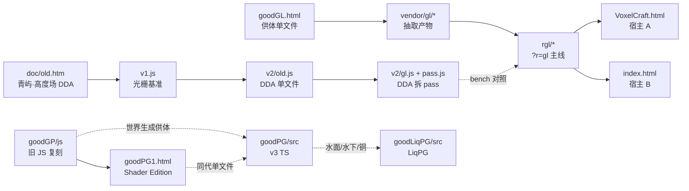

# 入口与引擎概览：一个仓库里的 8 个引擎、11 套渲染器

> 范围：`/home/aa/Proj/mc` 下所有可直接运行的页面、模块与 CLI 入口；`goodPG`（VoxelCraft v3）为主体，其余版本作为对照 / 供体。
> 前提：仓库根目录起静态服务 `http://localhost:8765/`（本机已起）；系统有 `chromium`。
> 路径均相对仓库根。标 `[INFERENCE]` 的是由代码读到、未逐条实跑的示例（参数名与取值来自源码，URL/命令本身未执行）。

---

## 0. 速查

| 入口 | 默认 | 最少参数 | 示例 |
|---|---|---|---|
| `/` = `/index.html` | 宿主 B（OPUSCRAFT），`?r=gl` | 无 | `http://localhost:8765/` |
| `/VoxelCraft.html` | 宿主 A，`v1` | 无 | `http://localhost:8765/VoxelCraft.html?r=v2/gl&seed=20240607` |
| `/goodGL.html` | 标题界面 | **`#auto`** | `http://localhost:8765/goodGL.html#auto&seed=1&rd=6` |
| `/goodGP/index.html` | 旧 JS 复刻 | 无 | `http://localhost:8765/goodGP/` |
| `/goodLiqPG/index.html` | LiqPG | 无 | `http://localhost:8765/goodLiqPG/` |
| `/goodPG1.html` | Shader Edition 单文件 | 无 | `http://localhost:8765/goodPG1.html?preset=High&autostart=1&seed=12345` |
| `/goodPG/index.html` | v3 客户端（TS 源入口） | 无 | `http://localhost:8765/goodPG/?mundo=test&autostart=1&offline=1` |
| `/goodPG/dist/client/index.html` | v3 构建产物 | 无 | `http://localhost:8765/goodPG/dist/client/?mundo=test` |
| `/bridge-mind.html` | 功能最全的老复刻 | 无 | `http://localhost:8765/bridge-mind.html?pack=res/survivalpack.zip` |
| `/doc/old.htm` | 青屿（研究原型） | 无 | `http://localhost:8765/doc/old.htm` |

10 个入口全部 `200`（`curl -o /dev/null -w '%{http_code}'` 实测）。`/goodPG/dist/voxelcraft/` **没有** `index.html`，不是入口。

URL 里最好写的三条硬约束：

1. `goodGL.html` 只读 **hash**，`?query` 被忽略 → `#a=1&b=2`。
2. `VoxelCraft.html` 的 `?r=` 只认白名单 `v1` / `v2/old` / `v2/gl` / `gl`；`?r=v2` 无别名，静默回落 `v1`。
3. `&json=` 只对 `v2/old`、`v2/gl` 生效（`rgl` **不读** json）；值要 URL 编码，`#json=` 同样有效。

---

## 1. 页面入口逐个

### 1.1 `index.html` — 宿主 B（OPUSCRAFT，three r170）

| 参数 | 取值 | 作用 |
|---|---|---|
| `r` | `gl`（默认）/ 其他 | 默认 `gl` = `rgl/host-b.js` 接 goodGL 管线；任何非 `gl` = 只用宿主 three |
| `tex` | zip URL | 资源包；抓取失败时回落到 `?tex=res/survivalpack.zip` |
| `xyzb` | bwebp URL | 用 URL 里的存档覆盖标题界面槽位 |

无 `seed` / `g` 参数（`goal-remix` 里写的 `?seed=&g=` 仍是计划）。种子在世界列表 / 新建世界界面选。

```
http://localhost:8765/index.html?r=gl
http://localhost:8765/index.html?tex=res/survivalpack.zip
http://localhost:8765/?r=three&xyzb=res/world.webp      [INFERENCE：xyzb 的 bwebp 文件]
```

### 1.2 `VoxelCraft.html` — 宿主 A（three r160 单模块）

| 参数 | 取值 | 作用 |
|---|---|---|
| `r` | `v1`（默认）/ `v2/old` / `v2/gl` / `gl` | 渲染器表：`./v1.js`、`./v2/old.js`、`./v2/gl.js`、`./rgl/index.js` |
| `seed` | 数字 | **一次性世界**：`noSave = true`，不读档不存档（基准/截图用） |
| `touch` | `1` | 强制触屏输入（否则看 `pointer: coarse`） |
| `json` | URL 编码 JSON | 仅 `v2/old`、`v2/gl`：`{P 键}` 顶层或 `{P:{},D:{},preset:'名'}` 分桶深赋值 |
| `passdev` | 无值 | 仅 `gl`：Pass DSL 开发模式（编译日志） |

```
http://localhost:8765/VoxelCraft.html?r=v1
http://localhost:8765/VoxelCraft.html?r=v2/gl&seed=20240607
http://localhost:8765/VoxelCraft.html?r=v2/gl&json=%7B%22scale%22%3A0.5%7D
http://localhost:8765/VoxelCraft.html?r=gl&seed=20240607&passdev
http://localhost:8765/VoxelCraft.html?r=gl&seed=20240607#json=%7B%22preset%22%3A%22vol%22%7D
```

### 1.3 `goodGL.html` — 方块纪元（goodGL 供体，单文件 6431 行）

启动流程：`Game.init()` → 无 hash 就停在标题界面 + 全景世界；`#auto` 才直接开局。

hash 键（`location.hash.slice(1)`，`&` 分隔，`+` 不转空格）：

| 键 | 默认 | 作用 |
|---|---|---|
| `auto` | — | 必需，出现即自动开局 |
| `seed` | `1` | 世界种子 |
| `mode` | `1` | 游戏模式 |
| `rd` | 存档值 | 视距 |
| `shader` | 存档值 | `1` = shaderpack（fancy）路径，`0` = vanilla 路径 |
| `scale` | `1` | `Game.renderScale`（不再走 `resize()` 的 2.1 MP 上限） |
| `x` `z` `y` | 出生点 | 传送；`y` 缺省 = 自动落地 |
| `t` | — | `Game.time`（tick，24000/天，0 = 06:00） |
| `nolock` | — | 不锁鼠标 |

```
http://localhost:8765/goodGL.html#auto&seed=1&rd=6
http://localhost:8765/goodGL.html#auto&seed=1&shader=1&scale=0.8&t=6000
http://localhost:8765/goodGL.html#auto&seed=63&x=-285.5&z=-150.5&y=104
```

### 1.4 `goodGP/index.html` — 旧 JS 复刻（经典 `<script>`，无构建）

0 处 `location.search/hash`，全部状态在 IndexedDB / 内存。直接开即可；`js/render.js` 是全局 `class Renderer`。

```
http://localhost:8765/goodGP/
```

### 1.5 `goodLiqPG/index.html` — LiqPG（原生 ESM，无构建）

无 URL 参数；设置读 `localStorage['mc.settings']`。
`SharedArrayBuffer` 需要 COOP/COEP（自带 `server.mjs`，`PORT` 或 argv[2]，默认 8080）；在普通静态服务（8765）下 `HAS_SAB=false`，区块退化为 `ArrayBuffer` + 拷贝/transfer，仍可跑。

```
http://localhost:8765/goodLiqPG/
PORT=8090 node goodLiqPG/server.mjs          # 有 SAB 的版本（跨源隔离）
```

### 1.6 `goodPG1.html` — Shader Edition（单文件，内联 `R3` 渲染器）

| 参数 | 取值 | 作用 |
|---|---|---|
| `preset` | `Ultra` / `High` / `Medium` / `Low` / `Potato` | `applyPreset`；无存档时先按 GPU 名自动选再被它覆盖 |
| `autostart` | 任意非空 | 开局（注意：**不是** `=== '1'` 判断） |
| `seed` | 数字，默认 `12345` | 世界种子 |
| `gm` | `0` / `1` / `2`，默认 `0` | 模式；`2` = hardcore |
| `wt` | `default` / `amplified` / `large` / `flat` | world type |

```
http://localhost:8765/goodPG1.html?preset=Potato
http://localhost:8765/goodPG1.html?autostart=1&seed=12345&gm=1&wt=default
```

### 1.7 `goodPG/index.html` 与 `goodPG/dist/client/index.html` — v3

| 参数 | 取值 | 作用 |
|---|---|---|
| `mundo` / `room` | 房间名 | `sanitizeRoomInput` 后作为房间；写入 localStorage 记忆 |
| `autostart` | 必须 `1` | 直接点「进入世界」（`params.get('autostart') === '1'`） |
| `offline` | `1` | 离线模式（本地模拟，不连 Worker） |

两条入口的差别只在加载方式：`goodPG/index.html` 先加载 `/src/client/main.ts`（需要 Vite / 支持 TS 转译的服务）；普通静态服务下该 module 404，页面内兜底脚本改载 `./dist/client/assets/index.js`——**dist 必须已构建**。

```
http://localhost:8765/goodPG/?mundo=test&autostart=1&offline=1
http://localhost:8765/goodPG/dist/client/index.html?mundo=test&autostart=1
cd goodPG && pnpm dev            # Vite 开发入口，默认 5173（[INFERENCE] 未改 port）
cd goodPG && pnpm build          # 重生成 dist/client，静态兜底才可用
```

### 1.8 `bridge-mind.html` — 老复刻（three r128 UMD + JSZip）

| 参数 | 默认 | 作用 |
|---|---|---|
| `pack` | `resourcepack.zip` | 资源包 URL |

```
http://localhost:8765/bridge-mind.html?pack=res/survivalpack.zip
```

### 1.9 `doc/old.htm` — 青屿（高度场研究原型）

无 URL 参数；4 套着色器（平滑 PBR / 线框 / 体素化 / Max-Mip DDA）在 Tweakpane 里切。

```
http://localhost:8765/doc/old.htm
```

---

## 2. 引擎概览

### 2.1 谱系



实线 = 代码/数据实际继承或复用；虚线 = 文档中确认的对照或单点取用（`goal-remix/README.md` §0）。

### 2.2 引擎对照

| 引擎 | 入口 | 世界高 | 区块存储 | 网格 | 渲染 | 存档 | 构建/依赖 |
|---|---|---|---|---|---|---|---|
| 青屿 | `doc/old.htm` | 高度场（无体素） | — | 24 段 `PlaneGeometry` / 体素化 | three：平滑 PBR / 线框 / 体素 / DDA raymarch | 无 | 单文件，three r170 + tweakpane |
| VoxelCraft A | `VoxelCraft.html` | `CH = 96` | `blocks` Uint8 + `sky`/`blk` Uint8，16×16×96 | 逐面剔除，顶点 `Int16` 定点 ×64 | `?r=` 四选一 | localStorage（差异 Map） | 单模块 + ESM 渲染器 |
| OPUSCRAFT（宿主 B） | `index.html` + `gls.js` | `CHUNK_H = 128` | `blocks`/`meta`/`sky`/`blk` 各 Uint8 + `height`/`biomes` | **greedy**（`Mesher`，按属性合并） | 默认 `?r=gl`，可退 three | bwebp（`bwebp.js`，palette+deflate） | 单文件 + 5 个共享脚本 + importmap |
| goodGP | `goodGP/js/*` | `HEIGHT = 256` | blocks + meta（`js/blocks.js`） | 逐面，32 B 顶点（pos/uv/layer+overlay/rgb/sky/blk/anim） | 前向 WebGL2（无阴影图/SSR/TAA） | IndexedDB | 经典 `<script>`，零依赖 |
| goodPG1 | `goodPG1.html` | `WH = 192` | 单文件内 `world.chunks` | 逐面 | 前向 + 阴影图 + 体积光 + SSR + 云 + bloom + FXAA | IndexedDB | 单文件，零依赖 |
| goodPG v3 | `goodPG/src/client/main.ts` | `MIN_Y=-64 … 320`（384） | 区块 `Uint16` blocks（`shared/sim/WorldSim.ts`）、服务端权威 | 逐面 + Worker | 见 §2.3 #9 | 服务端（Durable Object）+ 本地 | Vite + TS + gl-matrix + wrangler |
| LiqPG | `goodLiqPG/src/main.js` | `MIN_Y=-64`，`HEIGHT=384` | blocks Uint16 + biomes + heightmap，SAB 布局 | 逐面（`mesher.js`，段索引） | 阴影 → PBR gbuf → 水/SSR → 体积 → 合成 → TAA → bloom | IndexedDB | 原生 ESM，零依赖；可选 `server.mjs` |
| goodGL | `goodGL.html` | `H = 256`，`SEA = 63` | 单文件世界 | 逐面（无 greedy） | `renderVanilla` / `renderFancy` 双路径 | IndexedDB（`Store`） | 单文件，零依赖 |

### 2.3 渲染器 11 套

| # | 代号 | 入口 | API / 依赖 | 管线要点 | 示例 |
|---|---|---|---|---|---|
| 1 | `v1` | `v1.js` | `createRenderer(ctx)`；THREE.Mesh + ShaderMaterial | 逐面网格、顶点 AO、四角平滑光 | `VoxelCraft.html?r=v1` |
| 2 | `v2/old` | `v2/old.js` | 同契约；THREE 全屏材质 + `Data3DTexture` | 全屏 DDA、`uVox` RGBA8UI、Worker DF、软阴影 pass | `VoxelCraft.html?r=v2/old&seed=1` |
| 3 | `v2/gl` | `v2/gl.js` + `v2/pass.js` | 同契约；three | GLSL 模块 + Pass 模板，参数表单一真值 | `VoxelCraft.html?r=v2/gl` |
| 4 | `goodGL` | `goodGL.html` 内联 `Renderer` | 裸 WebGL2 | lut/shadow/scene/water/cloud/comp/taa/bloom/final | `goodGL.html#auto&shader=1` |
| 5 | `vendor/gl` | `vendor/gl/renderer.js` | `new Renderer(canvas)` | 同上两路径，`F` 由调用方给 | 仅供 `rgl` import |
| 6 | `gl`（rgl） | `rgl/index.js`（宿主 A）/ `rgl/host-b.js`（宿主 B） | `createRenderer(RCTX)` / `createGlRenderer(gg, scene)` | 上述 pass 表 + 实体/火/萤火/落叶/波纹 | `VoxelCraft.html?r=gl`、`index.html?r=gl` |
| 7 | `goodGP` | `goodGP/js/render.js` | 全局 `class Renderer` | 段化前向、天空/星/云、模型、图标 | `goodGP/` |
| 8 | Shader Edition | `goodPG1.html` 内联 `R3` | 单文件 | 阴影图 + 体积 + SSR + bloom + FXAA | `goodPG1.html?autostart=1` |
| 9 | goodPG v3 | `goodPG/src/client/render/Renderer.ts` | `class Renderer` + `render(FrameState)`；gl-matrix + UBO | 天空 LUT → 阴影 → 主 HDR → 水/冰 → 体积 → 合成 → TAA → 手/实体 → bloom/ACES | `goodPG/?autostart=1` |
| 10 | LiqPG | `goodLiqPG/src/render/renderer.js` + `pipeline.js` | `class Renderer` `render(cam, env)` | 阴影 → PBR gbuffer → 水/SSR → 体积 → 合成 → TAA → bloom/ACES，4 档质量 | `goodLiqPG/` |
| 11 | 青屿 | `doc/old.htm` | 单文件 | 4 套着色器 | `doc/old.htm` |

### 2.4 模块入口（`createRenderer` 契约）

宿主 A 的 `RCTX` 由 `VoxelCraft.html` 直接构造（`THREE/scene/camera/renderer/U/GLSL/MeshBuilder/makeGeometry/atlas/...`），返回对象需满足：

```js
{ name, buildChunk(c), disposeChunk(c), update(dt), render(), stats() }
// bench 追加：readOut(), programs, pending(), resetLag(), setRef(), setDebug(), perf
```

```js
// 宿主 A
const VR = (await import('http://localhost:8765/rgl/index.js')).createRenderer(RCTX);
// 宿主 B（第二个参数当前未使用：内部固定用 Game.scene）
const VR = await (await import('http://localhost:8765/rgl/host-b.js')).createGlRenderer(gg, gg.Game.scene);
// 直接跑 vendor 层（需自备 canvas 与 F/PBR/Textures）
import { Renderer } from 'http://localhost:8765/vendor/gl/renderer.js';
const R = new Renderer(canvas);            // 复用 three 已建的 webgl2 上下文
```

运行期句柄：宿主 A `window.game.VR`，宿主 B `gg.VR`（`bench-v2` / `bench-b` / verify 都从这两个名字取）。

`vendor/gl/index.js` 是桶文件（`export *` 7 个模块）；**不要手改** `vendor/gl/*`，改 `tools/vendor.mjs` 的补丁表后重生成。

---

## 3. CLI 工具入口

所有工具都是 Node（`node tools/x.mjs`），无第三方依赖；凡需页面的都用内置 CDP（`tools/cdp.mjs`）驱动无头 Chromium。`tools/cdp.mjs`、`tools/png.mjs` 是库，不是入口；`tools/pass-maps/` 是数据目录。

| 工具 | 必需参数 | 示例 | 前置 |
|---|---|---|---|
| `check.mjs` | — | `node tools/check.mjs` / `node tools/check.mjs --b` | `:8765` + chromium |
| `verify-renderer.mjs` | — | `node tools/verify-renderer.mjs --only static,gl --fast` | `:8765`；全量约 2 min |
| `verify-host-b.mjs` | — | `node tools/verify-host-b.mjs --fast` | `:8765` |
| `verify-autojump.mjs` | — | `node tools/verify-autojump.mjs` | `:8765`，约 10 s |
| `bench-v2.mjs` | — | `node tools/bench-v2.mjs --r v2/gl --views plain,canopy --save base` | `:8765`；`--cmp base` 做 0 px |
| `bench-b.mjs` | — | `node tools/bench-b.mjs --save b0` / `--find --views plain` | `:8765` |
| `frametime.mjs` | — | `node tools/frametime.mjs --seed 1 --rd 6` | 自起临时服务载 `goodGL.html`，不需要 8765 |
| `shader-stats.mjs` | — | `node tools/shader-stats.mjs 'http://localhost:8765/VoxelCraft.html?r=gl'` | Intel/Mesa + `INTEL_DEBUG=fs` |
| `upload-cost.mjs` | — | `node tools/upload-cost.mjs 'http://localhost:8765/VoxelCraft.html?r=v2/gl'` | `:8765` |
| `df-seeds.mjs` | 起始种子、结束种子 | `node tools/df-seeds.mjs 1 6 gpu 0,90` | `:8765` |
| `refdiff.mjs` | A、B、机位 | `node tools/refdiff.mjs base new plain 30` | 先有两组 `--save` |
| `fsdump.mjs` | — | `node tools/fsdump.mjs r=gl tools/out/fs/gl --vs` | `:8765` |
| `ripple-check.mjs` | — | `node tools/ripple-check.mjs` | `:8765`（默认 `VoxelCraft.html`） |
| `fire-skel.mjs` | — | `node tools/fire-skel.mjs --seed 20240607` | `index.html?r=gl` |
| `firefly-skel.mjs` | — | `node tools/firefly-skel.mjs --rd 6` | `index.html?r=gl` |
| `test-pass.mjs` | — | `node tools/test-pass.mjs` | 纯 Node，无浏览器 |
| `test-vars.mjs` | — | `node tools/test-vars.mjs` | 纯 Node |
| `test-pass-gl.mjs` | — | `node tools/test-pass-gl.mjs` | `:8765` |
| `vendor.mjs` | 供体名 | `node tools/vendor.mjs gl --check` | 纯 Node；`--cdp` 需页面 |
| `snap.mjs` | — | `node tools/snap.mjs --check` | 纯 Node |

常用组合：

```bash
# 改完代码：正确性闸门
node tools/check.mjs

# 结构改动：0 px 回归（先存基准，再比）
node tools/bench-v2.mjs --r gl --views plain,canopy,cave,water,uw --save gl0
node tools/bench-v2.mjs --r gl --views plain,canopy,cave,water,uw --cmp gl0

# 宿主 B 最小机位
node tools/bench-b.mjs --save b0
node tools/bench-b.mjs --cmp b0

# goodGL 原版整帧墙钟（自起服务；不需要 8765）
node tools/frametime.mjs --fog off --ablate

# 改 rgl/pass.js 后
node tools/test-pass.mjs && node tools/test-vars.mjs && node tools/test-pass-gl.mjs

# 供体是否被手改
node tools/vendor.mjs gl --check
```

---

## 4. 已知坑

1. **`goodGL.html` 用 hash**：`?auto` 不会开局，必须是 `#auto`；`#` 后面的 `&` 是它自己的分隔符。
2. **`?r=v2` 不存在**：`RENDERERS` 白名单没有它，会回落 `v1`（文档里旧写法要读作 `v2/old`）。
3. **`&json=` 的生效面**：只有 `v2/old` / `v2/gl`；`rgl` 不读，写进 `?r=gl` 的 URL 是静默无效。值必须 URL 编码（`%7B…%7D`）。
4. **`goodPG/` 静态兜底依赖构建产物**：`/src/client/main.ts` 在 8765 下 404 后才会去 import `./dist/client/assets/index.js`；改了 TS 不 `pnpm build` 就还是旧画面。
5. **LiqPG 无 COOP/COEP 时**：`HAS_SAB=false`，功能可跑但区块走拷贝/transfer；要真 SAB 用 `goodLiqPG/server.mjs`。
6. **`dist/voxelcraft/` 只有 assets**，没有 `index.html`，不能当入口。
7. **bench / verify 会先 `killStray()`** 清残留无头 Chromium（残留会抢 GPU 让墙钟作废）；跑基准时不要同时开别的 GPU 负载。
8. **`goodPG` 的 `autostart` 是严格 `'1'`**，而 `goodPG1` 的 `autostart` 是任意真值——两个入口别混用同一个 URL 常量。
